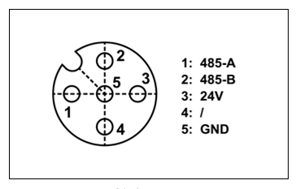
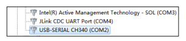
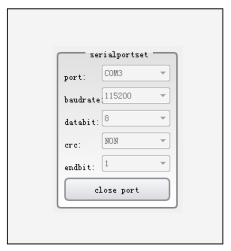
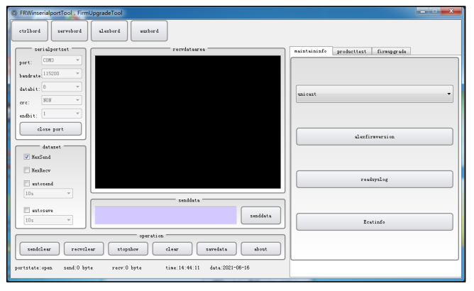
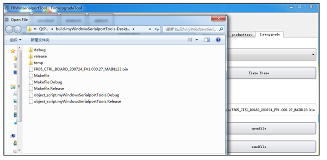
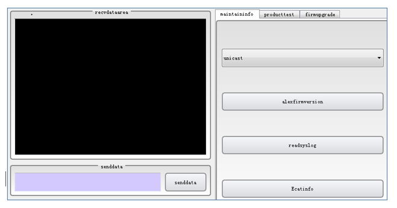
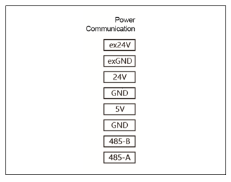

Anhang
======

.. toctree::
  :maxdepth: 5

Anhang 1: Fehler des Bewegungscontrollers und Behandlungsmethoden
------------------------------------------------------------------

.. csv-table:: 
   :header: "Hauptfehlercode", "Unterfehlercode", "Beschreibung"
   :widths: 20, 10, 70

   "0-Kein Fehler", "0", "Kein Fehler"
   "1-Befehlspunktfehler", "1", "Gelenk-Befehlspunktfehler, rücksetzbar"
   "1-Befehlspunktfehler", "2", "Linear-Zielpunktfehler (einschließlich Werkzeug-Nichtübereinstimmung), rücksetzbar"
   "1-Befehlspunktfehler", "3", "Kreisbogen-Zwischenpunktfehler (einschließlich Werkzeug-Nichtübereinstimmung), rücksetzbar"
   "1-Befehlspunktfehler", "4", "Kreisbogen-Zielpunktfehler (einschließlich Werkzeug-Nichtübereinstimmung), rücksetzbar"
   "1-Befehlspunktfehler", "5", "Abstand der Kreisbogen-Befehlspunkte zu klein, rücksetzbar"
   "1-Befehlspunktfehler", "6", "Vollkreis/Helix-Zwischenpunkt 1 Fehler (einschließlich Werkzeug-Nichtübereinstimmung), rücksetzbar"
   "1-Befehlspunktfehler", "7", "Vollkreis/Helix-Zwischenpunkt 2 Fehler (einschließlich Werkzeug-Nichtübereinstimmung), rücksetzbar"
   "1-Befehlspunktfehler", "8", "Vollkreis/Helix-Zwischenpunkt 3 Fehler (einschließlich Werkzeug-Nichtübereinstimmung), rücksetzbar"
   "1-Befehlspunktfehler", "9", "Abstand der Vollkreis/Helix-Befehlspunkte zu klein, rücksetzbar"
   "1-Befehlspunktfehler", "10", "TPD-Befehlspunktfehler, rücksetzbar"
   "1-Befehlspunktfehler", "11", "TPD-Befehlswerkzeug stimmt nicht mit aktuellem Werkzeug überein, rücksetzbar"
   "1-Befehlspunktfehler", "12", "Abweichung zwischen aktuellem TPD-Befehl und Startpunkt des nächsten Befehls zu groß, rücksetzbar"
   "1-Befehlspunktfehler", "13", "Fehler beim Umschalten zwischen internem/externem Werkzeug, rücksetzbar"
   "1-Befehlspunktfehler", "14", "Fehler des Startpunkts der neuen Helix, rücksetzbar"
   "1-Befehlspunktfehler", "15", "Fehler des Befehlspunkts der neuen Spline-Kurve, rücksetzbar"
   "1-Befehlspunktfehler", "17", "PTP-Gelenkbefehl überschreitet Grenzwert, rücksetzbar"
   "1-Befehlspunktfehler", "18", "TPD-Gelenkbefehl überschreitet Grenzwert, rücksetzbar"
   "1-Befehlspunktfehler", "19", "Von LIN/ARC ausgegebener Gelenkbefehl überschreitet Grenzwert, rücksetzbar"
   "1-Befehlspunktfehler", "20", "Befehl im kartesischen Raum über Geschwindigkeitsgrenze, nicht rücksetzbar"
   "1-Befehlspunktfehler", "21", "Drehmomentbefehl im Gelenkraum überschreitet Grenzwert, rücksetzbar"
   "1-Befehlspunktfehler", "22", "JOG-Gelenkbefehl überschreitet Grenzwert, rücksetzbar"
   "1-Befehlspunktfehler", "23", "Geschwindigkeit des Gelenkraum-Befehls von Achse 1 überschreitet Grenzwert, rücksetzbar"
   "1-Befehlspunktfehler", "24", "Geschwindigkeit des Gelenkraum-Befehls von Achse 2 überschreitet Grenzwert, rücksetzbar"
   "1-Befehlspunktfehler", "25", "Geschwindigkeit des Gelenkraum-Befehls von Achse 3 überschreitet Grenzwert, rücksetzbar"
   "1-Befehlspunktfehler", "26", "Geschwindigkeit des Gelenkraum-Befehls von Achse 4 überschreitet Grenzwert, rücksetzbar"
   "1-Befehlspunktfehler", "27", "Geschwindigkeit des Gelenkraum-Befehls von Achse 5 überschreitet Grenzwert, rücksetzbar"
   "1-Befehlspunktfehler", "28", "Geschwindigkeit des Gelenkraum-Befehls von Achse 6 überschreitet Grenzwert, rücksetzbar"
   "1-Befehlspunktfehler", "29", "Gelenk-Rückmeldegeschwindigkeit überschreitet Grenzwert, nicht rücksetzbar"
   "1-Befehlspunktfehler", "30", "Abweichung zwischen Gelenkbefehl und Rückmeldung zu groß, nicht rücksetzbar, Neustart erforderlich"
   "1-Befehlspunktfehler", "31", "DMP-Zielpunktfehler (einschließlich Werkzeug-Nichtübereinstimmung), rücksetzbar"
   "1-Befehlspunktfehler", "33", "Gelenkkonfiguration des nächsten Befehls geändert (nächster Befehl hat singuläre Pose, bitte PTP-Befehl verwenden oder nächsten Befehlspunkt ändern), rücksetzbar"
   "1-Befehlspunktfehler", "34", "Gelenkkonfiguration des aktuellen Befehls geändert (nächster Befehl hat singuläre Pose, bitte PTP-Befehl verwenden oder nächsten Befehlspunkt ändern), rücksetzbar"
   "1-Befehlspunktfehler", "35", "Gelenkgeschwindigkeit im LIN-Befehl überschreitet Grenzwert, rücksetzbar"
   "1-Befehlspunktfehler", "36", "Adaptive Geschwindigkeit des LIN-Befehls überschreitet Schwellenwert, rücksetzbar"
   "1-Befehlspunktfehler", "37", "Unreachbarer Punkt in der Trajektorie vorhanden, rücksetzbar"
   "1-Befehlspunktfehler", "38", "Unreachbarer Punkt in der Trajektorie vorhanden - singuläre Pose, rücksetzbar"
   "1-Befehlspunktfehler", "49", "Befehlfehler, zwischen ARCSTART und ARCEND sind nur LIN- und ARC-Befehle zulässig, rücksetzbar"
   "1-Befehlspunktfehler", "50", "Befehlfehler, zwischen WEAVESTART und WEAVEEND sind nur LIN- und ARC-Befehle zulässig, rücksetzbar"
   "1-Befehlspunktfehler", "51", "Fehler der Pendelparameter, rücksetzbar"
   "1-Befehlspunktfehler", "52", "Abstand der Pendel-Befehlspunkte zu klein, rücksetzbar"
   "1-Befehlspunktfehler", "53", "Unreachbarer Punkt in der Pendeltrajektorie vorhanden - singuläre Pose, rücksetzbar"
   "1-Befehlspunktfehler", "54", "Unreachbarer Punkt in der Pendeltrajektorie vorhanden - Gelenkbefehl überschreitet Grenzwert, rücksetzbar"
   "1-Befehlspunktfehler", "55", "Unreachbarer Punkt in der Pendeltrajektorie vorhanden - Planungsausnahme (Winkel zwischen Werkzeug-z und Vorschubrichtung-x fallen zusammen), rücksetzbar"
   "1-Befehlspunktfehler", "56", "Unreachbarer Punkt in der Pendeltrajektorie vorhanden - Planungsausnahme (Fehler des Kreisbogen-Wegpunkts), rücksetzbar"
   "1-Befehlspunktfehler", "65", "Abweichung des Laser-Sensorbefehls zu groß, rücksetzbar"
   "1-Befehlspunktfehler", "66", "Laser-Sensorbefehl unterbrochen, Schweißnahtverfolgung vorzeitig beendet, rücksetzbar"
   "1-Befehlspunktfehler", "81", "Geschwindigkeit des externen Achsenbefehls überschreitet Grenzwert, rücksetzbar"
   "1-Befehlspunktfehler", "82", "Abweichung zwischen externem Achsenbefehl und Rückmeldung zu groß, nicht rücksetzbar, Nullstellung oder Neustart erforderlich"
   "1-Befehlspunktfehler", "83", "Kommunikation der erweiterten Peripherie (externe Achse/IO) abnormal, rücksetzbar"
   "1-Befehlspunktfehler", "84", "Kommunikation der erweiterten Peripherie (Schweißgerät) abnormal, rücksetzbar"
   "1-Befehlspunktfehler", "85", "Geschwindigkeit des Gelenkraum-Befehls der erweiterten Achse 1 überschreitet Grenzwert, rücksetzbar"
   "1-Befehlspunktfehler", "86", "Geschwindigkeit des Gelenkraum-Befehls der erweiterten Achse 2 überschreitet Grenzwert, rücksetzbar"
   "1-Befehlspunktfehler", "87", "Geschwindigkeit des Gelenkraum-Befehls der erweiterten Achse 3 überschreitet Grenzwert, rücksetzbar"
   "1-Befehlspunktfehler", "88", "Geschwindigkeit des Gelenkraum-Befehls der erweiterten Achse 4 überschreitet Grenzwert, rücksetzbar"
   "1-Befehlspunktfehler", "89", "Kommunikation der erweiterten Peripherie (UDP) abnormal, rücksetzbar"
   "1-Befehlspunktfehler", "90", "Paketverlust in der Kommunikation der erweiterten Peripherie (UDP) abnormal, rücksetzbar"
   "1-Befehlspunktfehler", "97", "Förderbandverfolgung - Posenänderung zwischen Startpunkt und Referenzpunkt zu groß, rücksetzbar"
   "1-Befehlspunktfehler", "113", "Konstantkraftsteuerung - X-Richtung überschreitet maximale Verstellstrecke, rücksetzbar"
   "1-Befehlspunktfehler", "114", "Konstantkraftsteuerung - Y-Richtung überschreitet maximale Verstellstrecke, rücksetzbar"
   "1-Befehlspunktfehler", "115", "Konstantkraftsteuerung - Z-Richtung überschreitet maximale Verstellstrecke, rücksetzbar"
   "1-Befehlspunktfehler", "116", "Konstantkraftsteuerung - RX-Richtung überschreitet maximalen Verstellwinkel, rücksetzbar"
   "1-Befehlspunktfehler", "117", "Konstantkraftsteuerung - RY-Richtung überschreitet maximalen Verstellwinkel, rücksetzbar"
   "1-Befehlspunktfehler", "118", "Konstantkraftsteuerung - RZ-Richtung überschreitet maximalen Verstellwinkel, rücksetzbar"
   "1-Befehlspunktfehler", "119", "Datenfehler des externen Sensors, rücksetzbar"
   "1-Befehlspunktfehler", "120", "Helix-Erkundungsbewegung fehlgeschlagen, rücksetzbar"
   "1-Befehlspunktfehler", "121", "Rotierende Einführbewegung fehlgeschlagen, rücksetzbar"
   "1-Befehlspunktfehler", "122", "Lineare Einführbewegung fehlgeschlagen, rücksetzbar"
   "1-Befehlspunktfehler", "123", "Oberflächenpositionierungsbewegung fehlgeschlagen, rücksetzbar"
   "1-Befehlspunktfehler", "129", "Maximale Anzahl der Drehmoment-Aufzeichnungspunkte überschritten, rücksetzbar"
   "1-Befehlspunktfehler", "130", "Geschwindigkeitsumschaltfehler, rücksetzbar"
   "1-Befehlspunktfehler", "131", "Werkzeugrichtung überschreitet Grenzwert, rücksetzbar"
   "1-Befehlspunktfehler", "132", "Impuls überschreitet Grenzwert, rücksetzbar"
   "1-Befehlspunktfehler", "133", "Leistung überschreitet Grenzwert, rücksetzbar"
   "1-Befehlspunktfehler", "134", "STL-Flash-Diagnose abnormal, rücksetzbar"
   "1-Befehlspunktfehler", "135", "STL-RAM-Diagnose abnormal, rücksetzbar"
   "1-Befehlspunktfehler", "136", "STL-CPU-Diagnose abnormal, rücksetzbar"
   "1-Befehlspunktfehler", "137", "Sicherheitsplatine II - ECAT-Sicherheitsdaten abnormal, rücksetzbar"
   "1-Befehlspunktfehler", "138", "Achse 1 - ECAT-Sicherheitsdaten abnormal, rücksetzbar"
   "1-Befehlspunktfehler", "139", "Achse 2 - ECAT-Sicherheitsdaten abnormal, rücksetzbar"
   "1-Befehlspunktfehler", "140", "Achse 3 - ECAT-Sicherheitsdaten abnormal, rücksetzbar"
   "1-Befehlspunktfehler", "141", "Achse 4 - ECAT-Sicherheitsdaten abnormal, rücksetzbar"
   "1-Befehlspunktfehler", "142", "Achse 5 - ECAT-Sicherheitsdaten abnormal, rücksetzbar"
   "1-Befehlspunktfehler", "143", "Achse 6 - ECAT-Sicherheitsdaten abnormal, rücksetzbar"
   "1-Befehlspunktfehler", "145", "Kommunikation zwischen Sicherheitsplatine und Steuerkasten abnormal, rücksetzbar"
   "1-Befehlspunktfehler", "146", "Fokusverfolgungsfehler, rücksetzbar"
   "1-Befehlspunktfehler", "147", "Lagegeschwindigkeit überschreitet Grenzwert, rücksetzbar"
   "1-Befehlspunktfehler", "148", "Gelenkstatuswort abnormal, rücksetzbar"
   "1-Befehlspunktfehler", "149", "Funktions- oder Einstellungskonflikt, rücksetzbar"
   "2-Treiberfehler", "1", "Treiberfehler Achse 1, nicht rücksetzbar"
   "2-Treiberfehler", "2", "Treiberfehler Achse 2, nicht rücksetzbar"
   "2-Treiberfehler", "3", "Treiberfehler Achse 3, nicht rücksetzbar"
   "2-Treiberfehler", "4", "Treiberfehler Achse 4, nicht rücksetzbar"
   "2-Treiberfehler", "5", "Treiberfehler Achse 5, nicht rücksetzbar"
   "2-Treiberfehler", "6", "Treiberfehler Achse 6, nicht rücksetzbar"
   "3-Soft-Limit überschritten", "1", "Soft-Limit von Achse 1 überschritten, rücksetzbar"
   "3-Soft-Limit überschritten", "2", "Soft-Limit von Achse 2 überschritten, rücksetzbar"
   "3-Soft-Limit überschritten", "3", "Soft-Limit von Achse 3 überschritten, rücksetzbar"
   "3-Soft-Limit überschritten", "4", "Soft-Limit von Achse 4 überschritten, rücksetzbar"
   "3-Soft-Limit überschritten", "5", "Soft-Limit von Achse 5 überschritten, rücksetzbar"
   "3-Soft-Limit überschritten", "6", "Soft-Limit von Achse 6 überschritten, rücksetzbar"
   "4-Kollisionsfehler", "1", "Kollisionsfehler Achse 1, rücksetzbar"
   "4-Kollisionsfehler", "2", "Kollisionsfehler Achse 2, rücksetzbar"
   "4-Kollisionsfehler", "3", "Kollisionsfehler Achse 3, rücksetzbar"
   "4-Kollisionsfehler", "4", "Kollisionsfehler Achse 4, rücksetzbar"
   "4-Kollisionsfehler", "5", "Kollisionsfehler Achse 5, rücksetzbar"
   "4-Kollisionsfehler", "6", "Kollisionsfehler Achse 6, rücksetzbar"
   "4-Kollisionsfehler", "7", "Kollisionsfehler am Endeffektor, rücksetzbar"
   "4-Kollisionsfehler", "8", "Kollisionsfehler der externen Achse, rücksetzbar"
   "5-Fehler bei der Anzahl aktiver Slaves", "1", "Fehler bei der Anzahl aktiver Slaves, nicht rücksetzbar"
   "6-Slave-Fehler", "1", "Slave offline, nicht rücksetzbar"
   "6-Slave-Fehler", "2", "Slave-Status stimmt nicht mit dem eingestellten Wert überein, nicht rücksetzbar"
   "6-Slave-Fehler", "3", "Slave nicht konfiguriert, nicht rücksetzbar"
   "6-Slave-Fehler", "4", "Slave-Konfigurationsfehler, nicht rücksetzbar"
   "6-Slave-Fehler", "5", "Slave-Initialisierungsfehler, nicht rücksetzbar"
   "6-Slave-Fehler", "6", "Initialisierungsfehler der Slave-Mailbox-Kommunikation, nicht rücksetzbar"
   "7-IO-Fehler", "1", "Kanalfehler, rücksetzbar"
   "7-IO-Fehler", "2", "Wertfehler, rücksetzbar"
   "7-IO-Fehler", "3", "WaitDI-Wartezeitüberschreitung, rücksetzbar"
   "7-IO-Fehler", "4", "WaitAI-Wartezeitüberschreitung, rücksetzbar"
   "7-IO-Fehler", "5", "WaitAxleDI-Wartezeitüberschreitung, rücksetzbar"
   "7-IO-Fehler", "6", "WaitAxleAI-Wartezeitüberschreitung, rücksetzbar"
   "7-IO-Fehler", "7", "Funktion bereits auf dem Kanal konfiguriert, rücksetzbar"
   "7-IO-Fehler", "8", "Zeitüberschreitung beim Zünden des Lichtbogens, rücksetzbar"
   "7-IO-Fehler", "9", "Zeitüberschreitung beim Löschen des Lichtbogens, rücksetzbar"
   "7-IO-Fehler", "10", "Zeitüberschreitung bei der Nahtsuche, rücksetzbar"
   "7-IO-Fehler", "11", "Zeitüberschreitung bei der IO-Erkennung des Förderbands, rücksetzbar"
   "7-IO-Fehler", "12", "WaitAuxDI-Wartezeitüberschreitung, rücksetzbar"
   "7-IO-Fehler", "13", "WaitAuxAI-Wartezeitüberschreitung, rücksetzbar"
   "7-IO-Fehler", "14", "Zeitüberschreitung bei der Drahtnahtsuche, rücksetzbar"
   "7-IO-Fehler", "15", "Sicherheitsstopp ausgelöst, rücksetzbar"
   "7-IO-Fehler", "16", "24V-Kurzschlussschutz des DO-Moduls, nicht rücksetzbar"
   "7-IO-Fehler", "17", "Schutz der Positionshaltung (Bremsenausfall), nicht rücksetzbar"
   "7-IO-Fehler", "18", "Wartezeitüberschreitung beim DI der Platine, rücksetzbar"
   "7-IO-Fehler", "19", "Wartezeitüberschreitung beim AI der Platine, rücksetzbar"
   "8-Greiferfehler", "1", "Zeitüberschreitung der Greiferbewegung, rücksetzbar"
   "9-Dateifehler", "1", "Versionsfehler der zbt-Konfigurationsdatei, Initialisierungsfehler - nicht rücksetzbar"
   "9-Dateifehler", "2", "Laden der zbt-Konfigurationsdatei fehlgeschlagen, Initialisierungsfehler - nicht rücksetzbar"
   "9-Dateifehler", "3", "Versionsfehler der user-Konfigurationsdatei, Initialisierungsfehler - nicht rücksetzbar"
   "9-Dateifehler", "4", "Laden der user-Konfigurationsdatei fehlgeschlagen, Initialisierungsfehler - nicht rücksetzbar"
   "9-Dateifehler", "5", "Versionsfehler der exaxis-Konfigurationsdatei, Initialisierungsfehler - nicht rücksetzbar"
   "9-Dateifehler", "6", "Laden der exaxis-Konfigurationsdatei fehlgeschlagen, Initialisierungsfehler - nicht rücksetzbar"
   "9-Dateifehler", "7", "Robotermodell inkonsistent, Neukonfiguration erforderlich - nicht rücksetzbar"
   "9-Dateifehler", "8", "Versionsfehler der dhpara-Konfigurationsdatei, Initialisierungsfehler - nicht rücksetzbar"
   "9-Dateifehler", "9", "Laden der dhpara-Konfigurationsdatei fehlgeschlagen, Initialisierungsfehler - nicht rücksetzbar"
   "9-Dateifehler", "10", "Robotermodell nicht festgelegt - nicht rücksetzbar"
   "9-Dateifehler", "11", "Versionsfehler der load-Konfigurationsdatei, Initialisierungsfehler - nicht rücksetzbar"
   "9-Dateifehler", "12", "Laden der load-Konfigurationsdatei fehlgeschlagen, Initialisierungsfehler - nicht rücksetzbar"
   "9-Dateifehler", "13", "Versionsfehler der speed-Konfigurationsdatei, Initialisierungsfehler - nicht rücksetzbar"
   "9-Dateifehler", "14", "Laden der speed-Konfigurationsdatei fehlgeschlagen, Initialisierungsfehler - nicht rücksetzbar"
   "9-Dateifehler", "15", "Versionsfehler der weavepara-Konfigurationsdatei, Initialisierungsfehler - nicht rücksetzbar"
   "9-Dateifehler", "16", "Laden der weavepara-Konfigurationsdatei fehlgeschlagen, Initialisierungsfehler - nicht rücksetzbar"
   "9-Dateifehler", "17", "Versionsfehler der interfere-Konfigurationsdatei, Initialisierungsfehler - nicht rücksetzbar"
   "9-Dateifehler", "18", "Laden der interfere-Konfigurationsdatei fehlgeschlagen, Initialisierungsfehler - nicht rücksetzbar"
   "9-Dateifehler", "19", "Versionsfehler der dynamic-Konfigurationsdatei, Initialisierungsfehler - nicht rücksetzbar"
   "9-Dateifehler", "20", "Laden der dynamic-Konfigurationsdatei fehlgeschlagen, Initialisierungsfehler - nicht rücksetzbar"
   "10-Singuläre Pose", "1", "Singuläre Pose"
   "11-Treiberkommunikationsfehler", "1", "Treiberkommunikationsfehler Achse 1, nicht rücksetzbar"
   "11-Treiberkommunikationsfehler", "2", "Treiberkommunikationsfehler Achse 2, nicht rücksetzbar"
   "11-Treiberkommunikationsfehler", "3", "Treiberkommunikationsfehler Achse 3, nicht rücksetzbar"
   "11-Treiberkommunikationsfehler", "4", "Treiberkommunikationsfehler Achse 4, nicht rücksetzbar"
   "11-Treiberkommunikationsfehler", "5", "Treiberkommunikationsfehler Achse 5, nicht rücksetzbar"
   "11-Treiberkommunikationsfehler", "6", "Treiberkommunikationsfehler Achse 6, nicht rücksetzbar"
   "12-Soft-Limit der externen Achse", "1", "Soft-Limit von Achse 1 überschritten, rücksetzbar"
   "12-Soft-Limit der externen Achse", "2", "Soft-Limit von Achse 2 überschritten, rücksetzbar"
   "12-Soft-Limit der externen Achse", "3", "Soft-Limit von Achse 3 überschritten, rücksetzbar"
   "12-Soft-Limit der externen Achse", "4", "Soft-Limit von Achse 4 überschritten, rücksetzbar"
   "13-Fehler bei Parametereinstellung", "1", "Werkzeugnummer überschreitet Grenzwert, rücksetzbar"
   "13-Fehler bei Parametereinstellung", "2", "Fehler des Schwellenwerts für Positionierungsabschluss, rücksetzbar"
   "13-Fehler bei Parametereinstellung", "3", "Fehler der Kollisionsstufe, rücksetzbar"
   "13-Fehler bei Parametereinstellung", "4", "Fehler des Lastgewichts, rücksetzbar"
   "13-Fehler bei Parametereinstellung", "5", "Fehler des Lastschwerpunkts X, rücksetzbar"
   "13-Fehler bei Parametereinstellung", "6", "Fehler des Lastschwerpunkts Y, rücksetzbar"
   "13-Fehler bei Parametereinstellung", "7", "Fehler des Lastschwerpunkts Z, rücksetzbar"
   "13-Fehler bei Parametereinstellung", "8", "Fehler der DI-Filterzeit, rücksetzbar"
   "13-Fehler bei Parametereinstellung", "9", "Fehler der AxleDI-Filterzeit, rücksetzbar"
   "13-Fehler bei Parametereinstellung", "10", "Fehler der AI-Filterzeit, rücksetzbar"
   "13-Fehler bei Parametereinstellung", "11", "Fehler der AxleAI-Filterzeit, rücksetzbar"
   "13-Fehler bei Parametereinstellung", "12", "Fehler des DI-High/Low-Pegelbereichs, rücksetzbar"
   "13-Fehler bei Parametereinstellung", "13", "Fehler des DO-High/Low-Pegelbereichs, rücksetzbar"
   "13-Fehler bei Parametereinstellung", "14", "Werkstücknummer überschreitet Grenzwert, rücksetzbar"
   "13-Fehler bei Parametereinstellung", "15", "Nummer der externen Achse überschreitet Grenzwert, rücksetzbar"
   "13-Fehler bei Parametereinstellung", "16", "Fehler des Encoderkanals des Förderbands, rücksetzbar"
   "13-Fehler bei Parametereinstellung", "17", "Fehler der Werkstückachsnummer des Förderbands, rücksetzbar"
   "13-Fehler bei Parametereinstellung", "18", "Fehler der Installationsmethode des FR30L - keine aufrechte Montage, rücksetzbar"

Anhang 2: Fehlertabelle für den Breitspannungs-Steuerschrank
---------------------------------------------------------------------------------

.. list-table::
   :widths: 20 40 80
   :header-rows: 0
   :align: center

   * - **Fehlercode**
     - **Fehlername**
     - **Behandlungsmethode**

   * - 3
     - Hilfs-MCU offline
     - | 1. Firmware der Hilfs-MCU neu flashen
       | 2. Hilfs-MCU reparieren oder Steuerschrank austauschen  

   * - 4
     - Haupt- und Hilfs-MCU Not-Aus-Eingang nicht übereinstimmend
     - | 1. Not-Aus-Kabelbaum der Tasterbox prüfen oder Tasterbox-Baugruppe austauschen
       | 2. Die beiden Not-Aus-Brückenkabelbäume an den Steuerschrankklemmen prüfen  
       | 3. Wenn der Fehler weiterhin besteht, Steuerschrank reparieren oder austauschen 

   * - 5
     - Haupt- und Hilfs-MCU Sicherheitseingang nicht übereinstimmend
     - | 1. Die beiden Sicherheits-Brückenkabelbäume an den Steuerschrankklemmen prüfen
       | 2. Wenn der Fehler weiterhin besteht, Steuerschrank reparieren oder austauschen

   * - 6
     - Haupt- und Hilfs-MCU 3-Stellungs-Freigabe und Not-Aus-Eingang nicht übereinstimmend
     - | 1. 3-Stellungs-Freigabeschalter am Teach-Pendant und den Kabelbaum des Teach-Pendants prüfen
       | 2. Teach-Pendant-Baugruppe austauschen
       | 3. Prüfen, ob der Web im Teach-Pendant-Modus ist und ob das Teach-Pendant angeschlossen ist
       | 4. Wenn der Fehler weiterhin besteht, Steuerschrank reparieren oder austauschen

   * - 7
     - Haupt-STO-Eingang/Ausgang nicht übereinstimmend
     - | 1. Prüfen, ob der Schwerlaststecker des Steuerschranks und der STO-Kabelbaum fest eingesteckt sind
       | 2. Prüfen, ob der Antrieb die STO-Funktion unterstützt
       | 3. Bei Konfiguration Breitspannungs-zertifizierter Steuerschrank + nicht zertifizierter Roboter prüfen, ob der Functional-Safety-Modus aktiviert ist
       | 4. Der Breitspannungs-zertifizierte Steuerschrank aktiviert im Zertifizierungsmodus die STO-Fehlererkennung; der nicht zertifizierte Roboter unterstützt den Functional-Safety-Modus nicht
       | 5. Wenn der Fehler weiterhin besteht, Steuerschrank reparieren oder austauschen

   * - 8
     - Hilfs-STO-Eingang/Ausgang nicht übereinstimmend
     - | 1. Prüfen, ob der Schwerlaststecker des Steuerschranks und der STO-Kabelbaum fest eingesteckt sind
       | 2. Prüfen, ob der Antrieb die STO-Funktion unterstützt
       | 3. Bei Konfiguration Breitspannungs-zertifizierter Steuerschrank + nicht zertifizierter Roboter prüfen, ob der Functional-Safety-Modus aktiviert ist
       | 4. Der Breitspannungs-zertifizierte Steuerschrank aktiviert im Zertifizierungsmodus die STO-Fehlererkennung; der nicht zertifizierte Roboter unterstützt den Functional-Safety-Modus nicht
       | 5. Wenn der Fehler weiterhin besteht, Steuerschrank reparieren oder austauschen

   * - 9
     - Haupt-MCU erkennt 48V-Relais-Eingang/Ausgang nicht übereinstimmend
     - | 1. Eingang und Rückmeldung des zwangsgeführten Relais im Steuerschrank prüfen
       | 2. Prüfen, ob das 48V-Relais im Steuerschrank festklebt
       | 3. Prüfen, ob die 48V-Relais-Rückmeldeschaltung im Steuerschrank ordnungsgemäß funktioniert
       | 4. Wenn der Fehler weiterhin besteht, Steuerschrank reparieren oder austauschen

   * - 10
     - Hilfs-MCU erkennt 48V-Relais-Eingang/Ausgang nicht übereinstimmend
     - | 1. Eingang und Rückmeldung des zwangsgeführten Relais im Steuerschrank prüfen
       | 2. Prüfen, ob das 48V-Relais im Steuerschrank festklebt
       | 3. Prüfen, ob die 48V-Relais-Rückmeldeschaltung im Steuerschrank ordnungsgemäß funktioniert
       | 4. Wenn der Fehler weiterhin besteht, Steuerschrank reparieren oder austauschen

   * - \
     - Steuerschrank stromlos, keine 48V-Ausgangsspannung
     - | 1. Die 24V-Kurzschlussschutz-Chip-Schaltung prüfen und auf Kurzschlüsse bei 24V prüfen
       | 2. Die Brückenkabelbäume der Not-Aus-Eingangs- und Sicherheitseingangsklemmen prüfen
       | 3. Prüfen, ob die 24V-Stromversorgungsplatine im Steuerschrank 24V ausgibt
       | 4. Wenn der Fehler weiterhin besteht, Steuerschrank reparieren oder austauschen

Anhang 3: Fehlercodetabelle des Servoantriebs
----------------------------------------------

.. list-table::
   :widths: 20 40 80
   :header-rows: 0
   :align: center

   * - **Fehlercode**
     - **Fehlerbezeichnung**
     - **Behandlungsmethode**

   * - 1
     - Software-Überstromfehler
     - | 1. Prüfen, ob die Gelenklast oder der Widerstand größer oder anormal geworden ist.
       | 2. Wenn der Fehler weiterhin besteht, die Treiberplatine reparieren oder austauschen.

   * - 2
     - Überspannungsfehler
     - Robotergeschwindigkeit oder -beschleunigung reduzieren.

   * - 3
     - Unterspannungsfehler
     - | 1. Prüfen, ob die 48V-Stromversorgung des Steuerpults eine anormale Ausgangsspannung hat.
       | 2. Prüfen, ob die Treiberplatine und das Gelenkgehäuse kurzgeschlossen sind.
       | 3. Wenn der Fehler weiterhin besteht, die Treiberplatine reparieren oder austauschen.

   * - 4
     - Übertemperaturfehler
     - Robotlast reduzieren oder Robotergeschwindigkeit verringern.

   * - 5
     - Überlastfehler
     - Robotlast reduzieren oder Robotergeschwindigkeit verringern.

   * - 6
     - Überdrehzahlfehler
     - | 1. Prüfen, ob die Magnetgeber-Baugruppe und die Fixierschraube der Motorwelle locker sind.
       | 2. Die Encoder-Nullpunktkalibrierung wiederholen.
       | 3. Wenn der Fehler weiterhin besteht, die Magnetgeber-Baugruppe reparieren oder austauschen.

   * - 7
     - Parameterfehler
     - Treiberplatine reparieren oder austauschen.

   * - 8
     - Motor-Durchgehen-Fehler
     - | 1. Prüfen, ob die Magnetgeber-Baugruppe und die Fixierschraube der Motorwelle locker sind.
       | 2. Die Encoder-Nullpunktkalibrierung wiederholen.
       | 3. Wenn der Fehler weiterhin besteht, die Magnetgeber-Baugruppe reparieren oder austauschen.

   * - 9
     - Positionsfehler
     - | 1. Prüfen, ob die Gelenklast oder der Widerstand größer oder anormal geworden ist.
       | 2. Wenn der Fehler weiterhin besteht, die Treiberplatine reparieren oder austauschen.

   * - 10
     - Positionsüberlauffehler
     - | 1. Prüfen, ob der harte Endanschlag locker ist.
       | 2. Die Roboter-Nullpunktkalibrierung wiederholen.

   * - 11
     - Hardware-Überstromfehler
     - Treiberplatine reparieren oder austauschen.

   * - 12
     - Antriebssperrfehler
     - Nicht aktiviert.

   * - 13
     - Motorblockierfehler
     - | 1. Prüfen, ob die Bremse angezogen ist.
       | 2. Prüfen, ob der Roboter gegen den harten Endanschlag gefahren ist.
       | 3. Wenn der Fehler weiterhin besteht, die Treiberplatine reparieren oder austauschen.

   * - 14
     - Leistungsversorgungsfehler
     - Nicht aktiviert.

   * - 15
     - STO-Fehler
     - Nicht aktiviert.

   * - 16
     - Phasenstrom-AD-Abgleichfehler
     - Treiberplatine reparieren oder austauschen.

   * - 17
     - EEPROM-Fehler
     - Treiberplatine reparieren oder austauschen.

   * - 18
     - Hallsensor-Fehler
     - | 1. Prüfen, ob die Hallsensorkabel fest eingesteckt sind und ob Kurzschluss oder Unterbrechung vorliegt.
       | 2. Wenn der Fehler weiterhin besteht, das Gelenk reparieren oder austauschen.

   * - 19
     - Encoderfehler
     - Magnetgeber-Baugruppe reparieren oder austauschen.

   * - 20
     - Encoder-Nullabgleichfehler
     - | 1. Die Encoder-Nullpunktkalibrierung wiederholen.
       | 2. Wenn der Fehler weiterhin besteht, die Magnetgeber-Baugruppe reparieren oder austauschen.

   * - 21
     - Verlust des Encoder-Z-Impulses
     - Nicht aktiviert.

   * - 22
     - Encoder-Zählfehler
     - Nicht aktiviert.

   * - 23
     - Überlauf der Encoder-Multiturn-Daten
     - Nicht aktiviert.

   * - 24
     - Externer Taktfehler
     - Treiberplatine reparieren oder austauschen.

   * - 25
     - UVW-Phasenfolgefehler
     - Nicht aktiviert.

   * - 26
     - FPGA-Fehler
     - Nicht aktiviert.

   * - 27
     - Referenzpunktfahrt-Fehler
     - Nicht aktiviert.

   * - 28
     - Magnetischer Encoderfehler
     - | 1. Prüfen, ob die Magnetgeber-Baugruppe und die Fixierschraube der Motorwelle locker sind.
       | 2. Wenn der Fehler weiterhin besteht, die Magnetgeber-Baugruppe reparieren oder austauschen.

   * - 29
     - Motorleistungskabelunterbrechung
     - | 1. Prüfen, ob das Motorkabel fest eingesteckt ist und ob Kurzschluss oder Unterbrechung vorliegt.
       | 2. Wenn der Fehler weiterhin besteht, die Treiberplatine reparieren oder austauschen.

   * - 30
     - EtherCAT-Fehler
     - | 1. Prüfen, ob das Netzwerkkabel fest eingesteckt ist und ob Kurzschluss oder Unterbrechung vorliegt.
       | 2. Wenn der Fehler weiterhin besteht, die Treiberplatine reparieren oder austauschen.

   * - 31
     - EtherCAT_SM_DOG-Fehler
     - | 1. Prüfen, ob das Netzwerkkabel fest eingesteckt ist und ob Kurzschluss oder Unterbrechung vorliegt.
       | 2. Wenn der Fehler weiterhin besteht, die Treiberplatine reparieren oder austauschen.

   * - 32
     - EtherCAT_FATALSYNC-Fehler
     - | 1. Prüfen, ob das Netzwerkkabel fest eingesteckt ist und ob Kurzschluss oder Unterbrechung vorliegt.
       | 2. Wenn der Fehler weiterhin besteht, die Treiberplatine reparieren oder austauschen.

   * - 33
     - EtherCAT_SYNC-Fehler
     - | 1. Prüfen, ob das Netzwerkkabel fest eingesteckt ist und ob Kurzschluss oder Unterbrechung vorliegt.
       | 2. Wenn der Fehler weiterhin besteht, die Treiberplatine reparieren oder austauschen.

   * - 34
     - EtherCAT_RFT-Fehler
     - | 1. Prüfen, ob das Netzwerkkabel fest eingesteckt ist und ob Kurzschluss oder Unterbrechung vorliegt.
       | 2. Wenn der Fehler weiterhin besteht, die Treiberplatine reparieren oder austauschen.

   * - 35
     - Antriebs-Achsenadressfehler
     - | 1. Die Achsenadresse des Antriebs neu konfigurieren.
       | 2. Wenn der Fehler weiterhin besteht, die Treiberplatine reparieren oder austauschen.

   * - 36
     - Roboter-Nullpunktkalibrierungsfehler
     - | 1. Die Roboter-Nullpunktkalibrierung wiederholen.
       | 2. Zuerst den FLASH mit JLINK löschen, dann das Programm neu herunterladen und die Nullpunktkalibrierung durchführen.
       | 3. Wenn der Fehler weiterhin besteht, die Treiberplatine reparieren oder austauschen.

   * - 37
     - Encoder-Kommunikationsfehler
     - | 1. Prüfen, ob die Encoder-Kabel fest eingesteckt sind und ob Kurzschluss oder Unterbrechung vorliegt.
       | 2. Wenn der Fehler weiterhin besteht, die Magnetgeber-Baugruppe reparieren oder austauschen.

   * - 40
     - Magnetgebermodul-Fehler - Nullabgleichfehler
     - | 1. Die Nullpunktkalibrierung der Magnetgeber-Baugruppe wiederholen.
       | 2. Wenn der Fehler weiterhin besteht, die Magnetgeber-Baugruppe reparieren oder austauschen.

   * - 41
     - Magnetgebermodul-Fehler - Multiturn-Fehler
     - | 1. Prüfen, ob die Magnetgeber-Baugruppe und die Fixierschraube der Motorwelle locker sind.
       | 2. Wenn der Fehler weiterhin besteht, die Magnetgeber-Baugruppe reparieren oder austauschen.

   * - 42
     - Magnetgebermodul-Fehler - Multiturn-Klein-Magnetgeber-Fehler
     - | 1. Prüfen, ob der Multiturn-Klein-Magnetgeber-Chip anormal ist.
       | 2. Wenn der Fehler weiterhin besteht, die Magnetgeber-Baugruppe reparieren oder austauschen.

   * - 43
     - Magnetgebermodul-Fehler - Multiturn-Groß-Magnetgeber-Fehler
     - | 1. Prüfen, ob der Multiturn-Groß-Magnetgeber-Chip anormal ist.
       | 2. Wenn der Fehler weiterhin besteht, die Magnetgeber-Baugruppe reparieren oder austauschen.

   * - 44
     - Magnetgebermodul-Fehler - Singleturn-Magnetgeber-Fehler
     - | 1. Prüfen, ob der Singleturn-Magnetgeber-Chip anormal ist.
       | 2. Wenn der Fehler weiterhin besteht, die Magnetgeber-Baugruppe reparieren oder austauschen.

   * - 45
     - Magnetgebermodul-Fehler - Optischer Encoder-Fehler
     - | 1. Prüfen, ob die optische Codierscheibe verschmutzt oder nicht fest verklebt ist.
       | 2. Wenn der Fehler weiterhin besteht, die Magnetgeber-Baugruppe reparieren oder austauschen.

   * - 46
     - Robotertyp-Konfigurationsfehler
     - | 1. Ohne Spannungsunterbrechung die Firmware-Versionsnummer des fehlerhaften Antriebs prüfen
       | 2. Robotertyp neu konfigurieren
       | 3. Wenn der Fehler weiterhin besteht, Antriebsplatine austauschen oder reparieren

   * - 47
     - Bremsenspannungsprüfungsfehler
     - | 1. Prüfen, ob die Bremsenverkabelung fehlerhaft ist
       | 2. Prüfen, ob der Bremsenkreis fehlerhaft ist

   * - 50
     - Positionsbefehlfehler
     - | 1. Prüfen, ob der vom Host-Computer (Controller) gesendete Positionsbefehl fehlerhaft ist (oder Positionsbefehlssprung)

   * - 51
     - Magnetischer Encoder-Modulfehler - Optischer Encoder-Fehler
     - | 1. Prüfen, ob die Verkabelung des Drehmomentsensors fehlerhaft ist
       | 2. Wenn der Fehler weiterhin besteht, Drehmomentsensor reparieren oder austauschen

Anhang 4: Endplatten-485-Upgrade
---------------------------------

Bei der Verwendung vor Ort kann es vorkommen, dass die Firmware aktualisiert werden muss, um neue Anforderungen zu erfüllen. Hierfür wird eine neue Upgrade-Datei (XX_XX_MAIN.bin) bereitgestellt. Das Upgrade der Endplatte erfolgt über die 485-Schnittstelle (mit Hilfe eines USB-zu-485-Moduls). Die Upgrade-Schritte sind wie folgt:

**Schritt 1: 485-Verdrahtung:** Am Roboterende befindet sich ein 5-poliger Rundsteckverbinder für die Kommunikation. Die Pin-Belegung des Rundsteckverbinders ist in Abbildung 1 dargestellt. Verbinden Sie die Klemmen 485-A und 485-B am Roboterende mit den Klemmen A und B des USB-zu-485-Werkzeugs mittels Twisted-Pair-Kabel.

.. centered:: Abbildung 18.3-1 Pin-Belegung des Rundsteckverbinders

**Schritt 2: Hardware-Verbindung:** Verbinden Sie die USB-Seite des USB-zu-485-Werkzeugs mit einem PC. Wenn das USB-zu-485-Werkzeug im PC-Geräte-Manager erkannt wird, erscheint die folgende Oberfläche.

.. centered:: Abbildung 18.3-2 Erkennung des USB-zu-485-Ports

**Schritt 3: Upgrade-Werkzeug:** Öffnen Sie nach Abschluss der Verdrahtung das "FAIRINO Serielles Debug-Assistenten"-Programm. Klicken Sie auf die Schaltfläche "Endplatte". Wählen Sie im Bereich "Serielle Parametereinstellungen" den oben erkannten seriellen Port aus, stellen Sie die Baudrate auf 115200, Datenbits auf 8, Parität auf Keine, Stoppbits auf 1 ein und öffnen Sie dann den seriellen Port. Bei Erfolg erscheint die Meldung "Serieller Port erfolgreich geöffnet".

.. centered:: Abbildung 18.3-3 Einstellung der seriellen Parameter

**Schritt 4: Firmware-Upgrade:** Wählen Sie "Endplatte" und klicken Sie auf "Firmware-Upgrade", wie in der Abbildung gezeigt:

.. centered:: Abbildung 18.3-4 Firmware-Upgrade der Endplatte

-   Klicken Sie zuerst auf "Flash löschen". Nach erfolgreichem Löschen erscheint im Datenempfangsbereich ein Hinweis auf den Löscherfolg.

-   Öffnen Sie die Datei (die zu aktualisierende Datei), indem Sie den Speicherpfad auswählen, wie unten gezeigt. Nach der Auswahl wird der Name der zu aktualisierenden Datei im Dateinamen-Anzeigefeld angezeigt.

.. centered:: Abbildung 18.3-5 Auswahl der Upgrade-Datei

-   Klicken Sie auf "Datei senden". Wenn der Fortschrittsbalken 100% erreicht, ist das Senden der Upgrade-Datei abgeschlossen.

**Schritt 5: Upgrade-Überprüfung:** Starten Sie das System neu (aus- und wieder einschalten). Wählen Sie im Bereich "Wartungsinformationen" die Option "Firmware-Versionsinfo der Endplatte abfragen". Im "Datenempfangsbereich" werden die Firmware-Versionsinformationen angezeigt. Wenn diese mit der Version der aktualisierten Datei übereinstimmen, war das Upgrade erfolgreich, andernfalls ist es fehlgeschlagen.

.. centered:: Abbildung 18.3-6 Abfrage der Firmware-Versionsinformationen

Anhang 5: Steuerpult-485-Upgrade
---------------------------------

Auf der Platine des Roboter-Steuerpults befindet sich eine "Stromversorgung/Kommunikation"-Schnittstelle. Verbinden Sie die Klemmen A und B des USB-zu-485-Werkzeugs mit den Klemmen "485-A" und "485-B" dieser Schnittstelle.

Der Upgrade-Vorgang ist derselbe wie bei der Endplatte; wählen Sie einfach die entsprechende Software-Option aus. Eine erneute Beschreibung entfällt hier.

.. centered:: Abbildung 18.4-1 Stromversorgungs-/Kommunikationsschnittstelle

Anhang 6: Liste der Ersatz- und Verschleißteile
------------------------------------------------

.. list-table::
   :widths: 40 40 20
   :header-rows: 0
   :align: center

   * - **Teil**
     - **Nummer**
     - **Menge**

   * - Schraube M8*30
     - 4.0.08.2006185
     - 4

   * - Zylinderstift Typ A 8x20
     - 4.5.00.2013076
     - 2

   * - Sicherung 5x20 6A
     -
     - 1