Sicherheit
===============

.. toctree:: 
   :maxdepth: 6

Hintergrund
------------------------------------------------
Als zentrale Ausführungseinheit in der Entwicklung der industriellen intelligenten Fertigung ist die Sicherheitsleistung von Industrierobotern zu einem Kernelement im gesamten Lebenszyklusmanagement von Geräten geworden. Derzeit fordert die Branche allgemein, dass sicherheitsfunktionsbezogene Parameter unveränderlich und manipulationssicher sind und dass ein vollständiger und rückverfolgbarer Verifizierungsmechanismus eingerichtet wird, um strenge Anforderungen an Sicherheitskonformitätsaudits zu erfüllen.
Systemintegratoren und Endbenutzer in Europa haben in der tatsächlichen Projektabnahme weitere klare Anforderungen an die Transparenz und Überprüfbarkeit von Sicherheitskonfigurationen gestellt. Konkret sollte das System nach Abschluss des Debuggings der Sicherheitsfunktionen automatisch einen Sicherheitskonfigurationsbericht mit einer vollständigen Prüfsumme (Checksum) generieren können, und diese Prüfsumme muss in Echtzeit in der Web-Verwaltungsoberfläche des Geräts angezeigt werden. Dieser Mechanismus soll sicherstellen, dass alle Änderungen an Sicherheitsparametern effektiv erkannt und aufgezeichnet werden können, um so eine zuverlässige Grundlage für die Bewertung des Sicherheitszustands des Geräts, die Abnahme vor Ort und die spätere Wartung zu schaffen.
Vor diesem Hintergrund entspricht das Sicherheitsarchitekturdesign dieses Geräts nicht nur den relevanten internationalen Sicherheitsstandards, sondern verfügt auch über integrierte Funktionen zum Export von Sicherheitskonfigurationen und zur Echtzeitanzeige der Prüfsumme, um Bediener und Sicherheitsverantwortliche bei der bequemen und zuverlässigen Durchführung von Konfigurationsbestätigungen und Konformitätsnachweisen zu unterstützen.

Prüfsumme der Sicherheitskonfiguration
------------------------------------------------

Öffnen Sie die Webseite. Die Sicherheitsprüfsumme befindet sich in der oberen rechten Ecke der Seite und wird durch eine 8-stellige Hexadezimalzahl dargestellt. Die Sicherheitsprüfsumme ist eindeutig; wenn sich die Sicherheitskonfigurationsparameter ändern, ändert sich die Sicherheitsprüfsumme entsprechend.

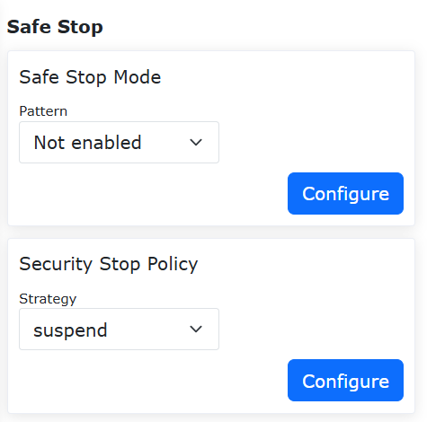

.. centered:: Abbildung 7.1-1 Anzeige der Sicherheitskonfigurations-Prüfsumme

Klicken Sie auf die Sicherheitsprüfsumme, um die Menge der Sicherheitskonfigurationsparameter anzuzeigen, die durch die aktuelle Prüfsumme dargestellt wird.

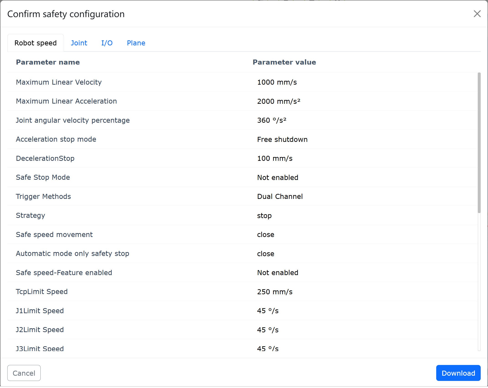

.. centered:: Abbildung 7.1-2 Sicherheitskonfigurationsparameter

Die Sicherheitskonfigurationsparameter unterstützen den Export von PDF-Berichten. Klicken Sie auf Download, um eine Vorschau des PDF-Berichts anzuzeigen, und er unterstützt auch den Export. Klicken Sie auf die Schaltfläche Speichern, um den PDF-Bericht herunterzuladen.

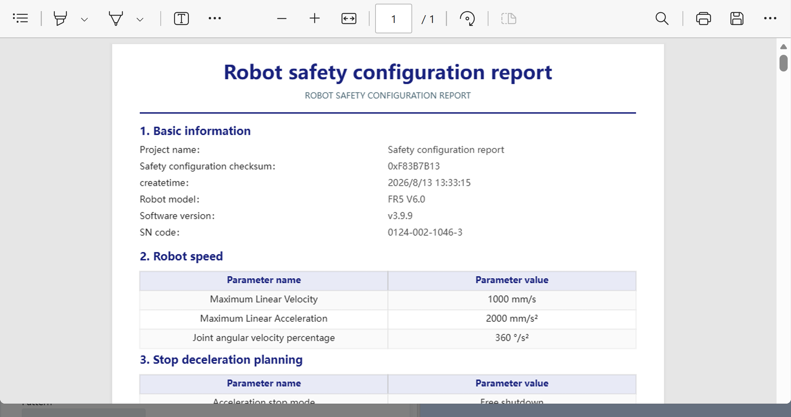

.. centered:: Abbildung 7.1-3 PDF-Vorschau des Sicherheitskonfigurationsberichts

Verwaltung der Sicherheitskonfigurationsparameter
----------------------------------------------------------

Alle roboterbezogenen Sicherheitskonfigurationsparameter werden einheitlich auf der Webseite unter "Grundeinstellungen" -> "Sicherheit" verwaltet. Die Änderung von Sicherheitskonfigurationsparametern erfordert die Eingabe des "Sicherheitskonfigurationskennworts" zur Überprüfung. Erst nach erfolgreicher Überprüfung können Änderungen an der Sicherheitsparameterkonfiguration vorgenommen werden.

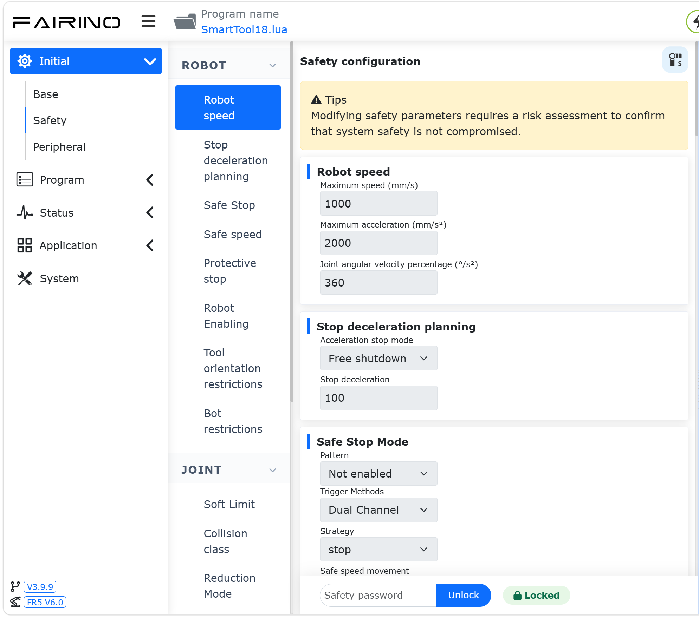

.. centered:: Abbildung 7.2-1 Überprüfung des Sicherheitskonfigurationskennworts

Nach der Änderung der Sicherheitskonfigurationsparameter klicken Sie auf "Übernehmen". Eine zweite Bestätigung der geänderten Sicherheitskonfigurationsparameter ist erforderlich. Klicken Sie auf "Bestätigen", um die Parameter zu übernehmen. Nach erfolgreicher Übernahme der Parameter wird die Sicherheitskonfigurations-Prüfsumme entsprechend aktualisiert.

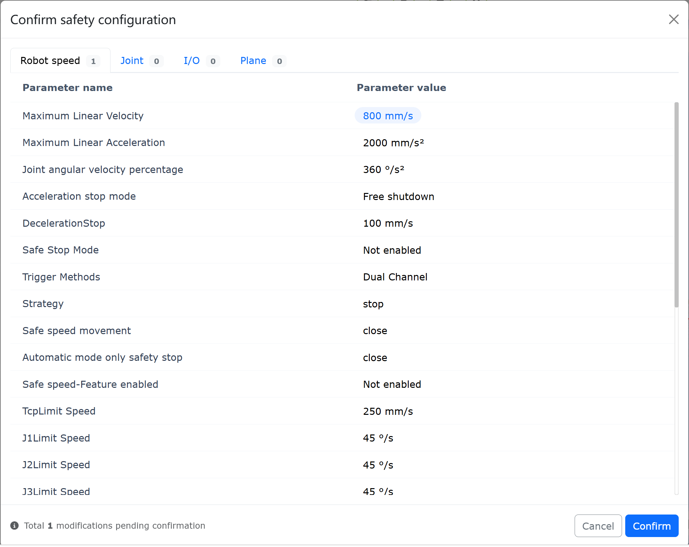

.. centered:: Abbildung 7.2-2 Zweite Bestätigung der Sicherheitskonfigurationsparameter

Cybersicherheitsfunktionen
------------------------------------------------------------------------

Verwaltung des Sicherheitskennworts
~~~~~~~~~~~~~~~~~~~~~~~~~~~~~~~~~~~~~~~~~~~~~~~~~~~~~~~~~~~~~~~~~~~~~~~~~~~~~~

Änderung des Sicherheitskennworts
+++++++++++++++++++++++++++++++++++++++++++++++++++++++++++++++++++++

Das Standard-Sicherheitskennwort ist „12345678“. Das Sicherheitskennwort kann auf der Seite „Sicherheit“ geändert werden. Klicken Sie auf die Schaltfläche „Sicherheitskennwort ändern“, um das Fenster zur Änderung des Sicherheitskennworts zu öffnen. Geben Sie das alte Kennwort und das neue Kennwort ein, um die Änderung des Sicherheitskennworts abzuschließen.

.. centered:: Abbildung 7.3-1 Schaltfläche zur Änderung des Sicherheitskennworts

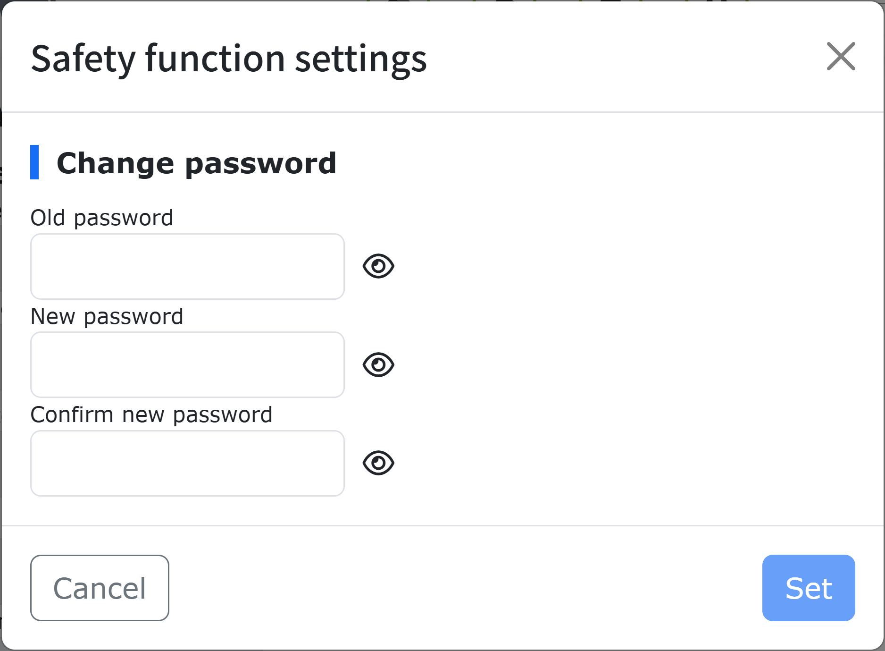

.. centered:: Abbildung 7.3-2 Fenster zur Änderung des Sicherheitskennworts

Das neue und das alte Sicherheitskennwort dürfen nicht identisch sein. Das Sicherheitskennwort muss mindestens 8 Zeichen lang sein und muss Groß- und Kleinbuchstaben, Ziffern und Sonderzeichen enthalten.

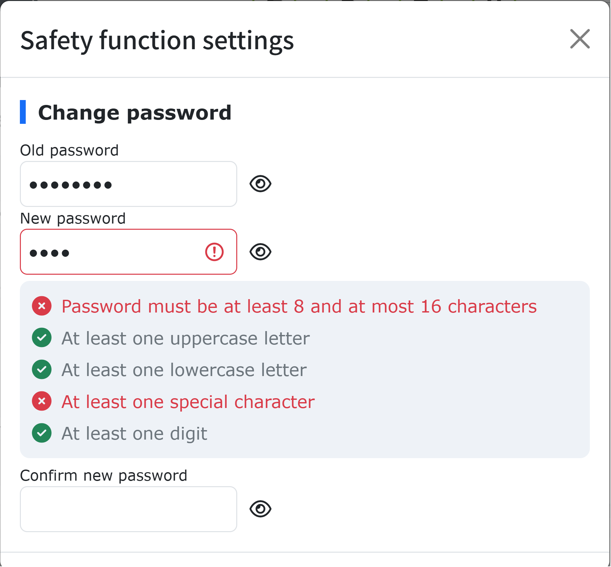

.. centered:: Abbildung 7.3-3 Überprüfung der Komplexität des Sicherheitskennworts

Schutz des Sicherheitskennworts
+++++++++++++++++++++++++++++++++++++++++++++++++++++++++++++++++++++

Die Entsperrung durch Eingabe des Robotersicherheitskennworts verfügt über eine Anti-Brute-Force-Funktion. Wenn fünfmal hintereinander ein falsches Kennwort eingegeben wird und der Abstand zwischen den einzelnen Versuchen jeweils weniger als 1 Minute beträgt, wird die Eingabe des Sicherheitskennworts für 1 Minute gesperrt. Innerhalb dieser 1 Minute kann das Kennwort nicht zur Entsperrung eingegeben werden, und in der WebApp wird ein Countdown angezeigt.

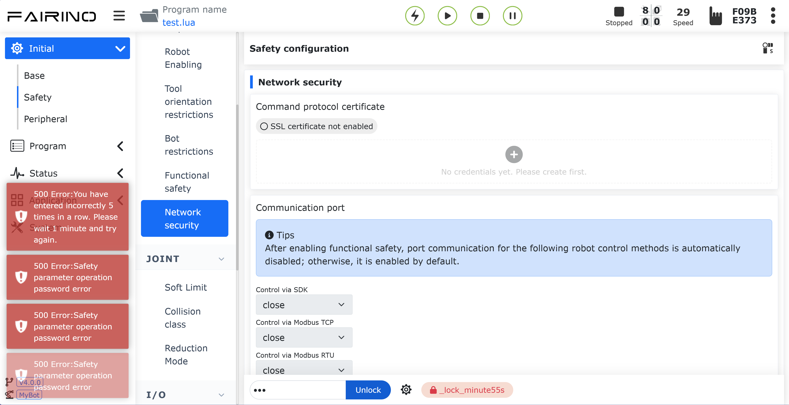

.. centered:: Abbildung 7.3-4 Anti-Brute-Force-Sperre des Sicherheitskennworts

Cybersicherheit
~~~~~~~~~~~~~~~~~~~~~~~~~~~~~~~~~~~~~~~~~~~~~~~~~~~~~~~~~~~~~~~~~~~~~~~~

Die Cybersicherheitsfunktionen des Roboters umfassen verschlüsselte Kommunikation von Befehlprotokollen, standardmäßige Deaktivierung nicht verschlüsselter Kommunikationsports, Software-Aktualisierungen, Integritätsprüfung während des Starts usw., die für Identitätsauthentifizierung, Anti-Abhören und Anti-Manipulation, Abwehr von Netzwerkangriffen und Gewährleistung einer kontrollierbaren und sicheren Kommunikation verwendet werden.

Informationen zur Netzwerksicherheitsumgebung
+++++++++++++++++++++++++++++++++++++++++++++++++++++++++++++++++++++

Benutzer müssen die folgenden Umgebungsanforderungen erfüllen, damit die Netzwerksicherheitsfunktionen des kollaborativen Roboters wirksam sind. Wenn die Umgebung die Anforderungen nicht erfüllt, kann die Sicherheitsschutzfähigkeit des kollaborativen Roboters beeinträchtigt werden und es können Sicherheitsrisiken bestehen.

Physische Sicherheitsumgebung
*******************************************************************************

① Der Robotercontroller und alle durchlaufenen Switches müssen in einem Steuerschrank mit Verriegelungseinrichtung installiert sein. Nicht autorisiertem Personal ist das Öffnen der Schranktür strengstens untersagt. Ohne Genehmigung ist es verboten, die Ethernet-Anschlüsse und Sicherheits-I/O-Anschlüsse des Controllers oder andere Schnittstellen zu berühren.

② Der Ethernet-Anschluss des Robotercontrollers darf nur zum Anschluss an einen Industrie-PC verwendet werden. Es ist verboten, einen privaten Computer direkt oder über einen Switch an den Netzwerkanschluss des Controllers anzuschließen. Nicht autorisiertes Personal darf den Industrie-PC, der mit dem Roboter vernetzt ist, nicht berühren. Legen Sie ein Anmeldepasswort für den Industrie-PC fest.

③ Das Teach-Pendant und die Tasterbox des Roboters sollten in einem sicheren Arbeitsbereich aufgestellt werden. Nicht autorisiertem Personal ist der Zutritt zu diesem Bereich untersagt.

Sicherheitskonfiguration des Roboters
*******************************************************************************

① Richten Sie WebApp-Anmeldekonten mit entsprechenden Berechtigungen für Personal mit unterschiedlichen Berechtigungen ein, insbesondere für Software-/Firmware-Upgrades und die Konfiguration von Sicherheitsparametern;

② Ändern Sie das Administrator-Anmeldepasswort der Roboter-WebApp und das Sicherheitskonfigurationspasswort. Bewahren Sie die Passwörter sicher auf, um Offenlegung zu vermeiden;

③ Aktivieren Sie bei der Kommunikation über das Befehlprotokoll die Verschlüsselung, und bewahren Sie alle vom Roboter heruntergeladenen Netzwerkkommunikations-Verschlüsselungszertifikate sicher auf. Die Offenlegung von Zertifikaten ist strengstens verboten.

④ Halten Sie nicht verschlüsselte Kommunikationsanschlüsse standardmäßig deaktiviert. Aktivieren Sie sie nur, wenn es notwendig ist.

Versionsanforderungen für Netzwerksicherheitsfunktionen
+++++++++++++++++++++++++++++++++++++++++++++++++++++++++++++++++++++

Roboter-Softwareversion V4.0.0 und höher unterstützt Netzwerksicherheitsfunktionen. Roboter-Software mit einer niedrigeren Versionsnummer als dieser unterstützt keine Netzwerksicherheitsfunktionen.

WebApp-Kommunikationsverschlüsselung
+++++++++++++++++++++++++++++++++++++++++++++++++++++++++++++++++++++

Die WebApp-Kommunikation des Roboters verwendet TLS 1.2 HTTPS-verschlüsselte Kommunikation. Bei der Verwendung der WebApp muss ein Zertifikat installiert werden (wenn das Zertifikat nicht installiert ist, zeigt der Browser eine unsichere Verbindung an). Die einzelnen Schritte sind wie folgt:

① Geben Sie die Roboter-IP-Adresse in den Browser ein, z. B. 192.168.58.2, und drücken Sie die Eingabetaste, um auf die WebApp-Seite des Roboters zuzugreifen. Zu diesem Zeitpunkt zeigt der Browser einen Hinweis auf eine unsichere Verbindung an.

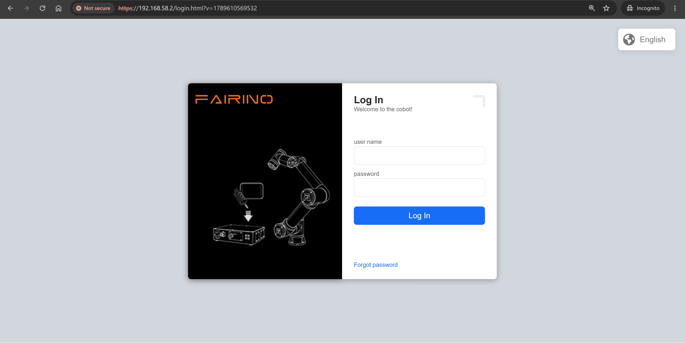

.. centered:: Abbildung 7.3-5 Unsichere Verbindung wird angezeigt

② Klicken Sie links neben dem IP-Adresseneingabefeld auf „Nicht sicher“, um das Fenster mit den Verbindungsdetails zu öffnen.

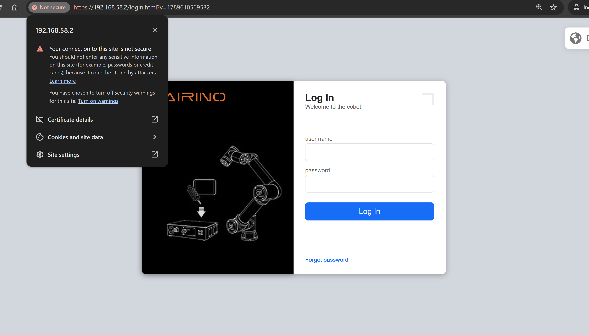

.. centered:: Abbildung 7.3-6 Fenster mit Verbindungsdetails geöffnet

③ Klicken Sie im Fenster auf „Zertifikatsdetails“, um das Fenster mit den Zertifikatsdetails zu öffnen. Wählen Sie im oberen Tab „Details“ und klicken Sie auf die Schaltfläche „Exportieren“, um das Zertifikat herunterzuladen. Der Name des heruntergeladenen Zertifikats ist normalerweise die Roboter-IP-Adresse. Sie müssen die Datei umbenennen und die Erweiterung „.crt“ hinzufügen, z. B. „192.168.58.2“ in „192.168.58.2.crt“ ändern.

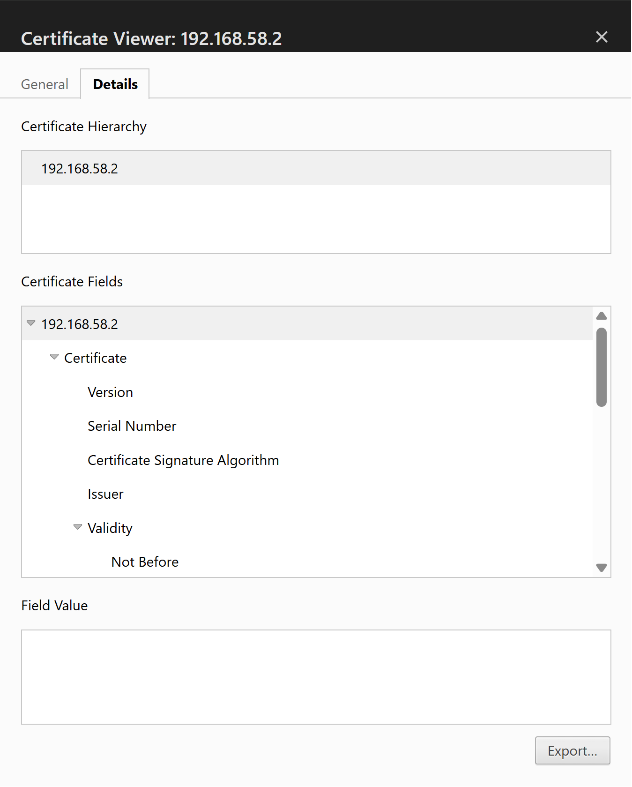

.. centered:: Abbildung 7.3-7 Fenster mit Zertifikatsdetails

.. image:: safety/053.png
   :width: 4in
   :align: center

.. centered:: Abbildung 7.3-8 Zertifikatsdateiname

④ Doppelklicken Sie auf die Zertifikatsdatei, um das Fenster zur Zertifikatsinstallation zu öffnen, und klicken Sie auf „Zertifikat installieren“.

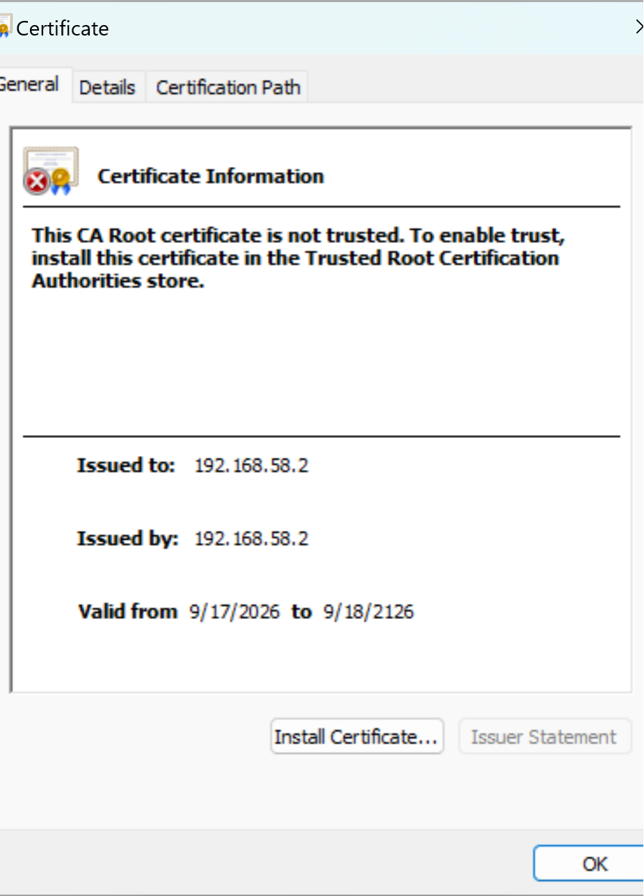

.. centered:: Abbildung 7.3-9 Fenster zur Zertifikatsinstallation

⑤ Wählen Sie im angezeigten Zertifikatsinstallationsassistenten als Speicherort „Lokaler Computer“ und klicken Sie auf Weiter.

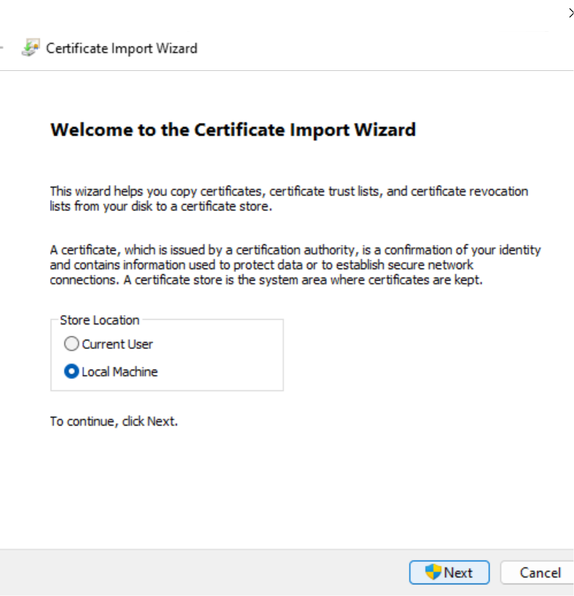

.. centered:: Abbildung 7.3-10 Speicherort als lokaler Computer auswählen

⑥ Wählen Sie im Zertifikatsassistentenfenster „Alle Zertifikate in folgendem Speicher ablegen“, klicken Sie auf die Schaltfläche „Durchsuchen“ und wählen Sie „Vertrauenswürdige Stammzertifizierungsstellen“. Klicken Sie auf Weiter.

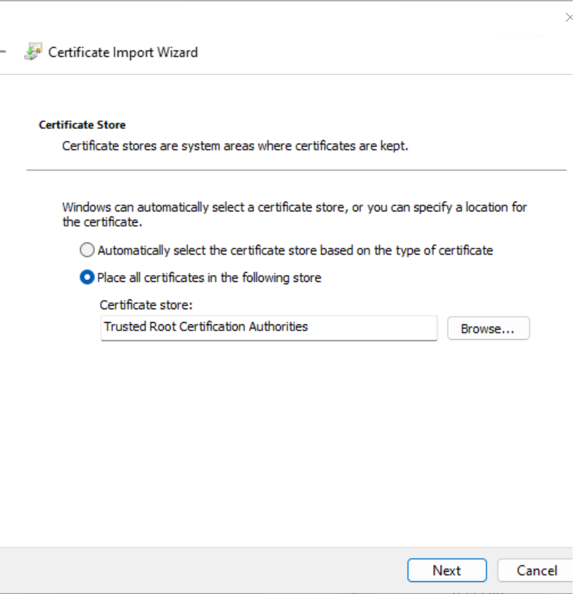

.. centered:: Abbildung 7.3-11 Vertrauenswürdige Stammzertifizierungsstelle auswählen

⑦ Klicken Sie auf „Fertig stellen“.

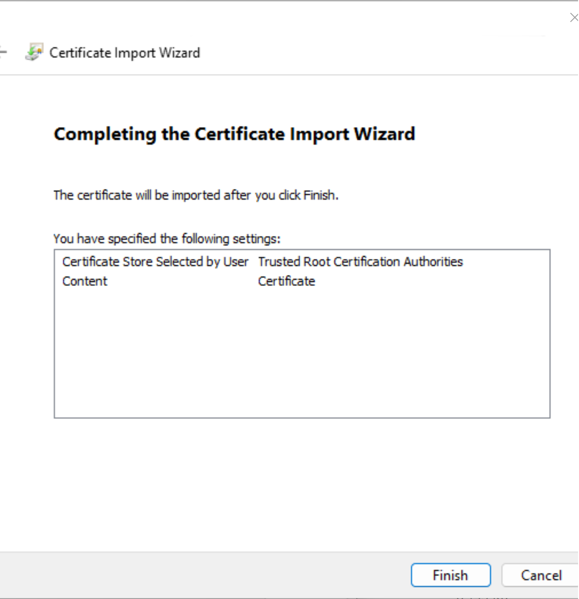

.. centered:: Abbildung 7.3-12 WebApp-Zertifikatsinstallation abgeschlossen

Starten Sie den Browser neu und melden Sie sich bei der WebApp an; es wird eine normale sichere Verbindung angezeigt.

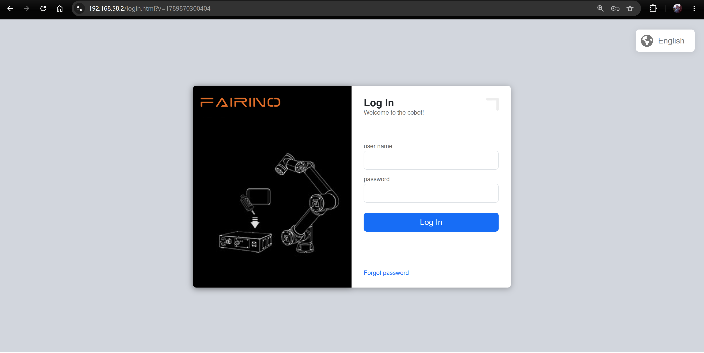

.. centered:: Abbildung 7.3-13 Sichere Verbindung nach Installation des WebApp-Zertifikats

Befehlprotokollverschlüsselung
+++++++++++++++++++++++++++++++++++++++++++++++++++++++++++++++++++++

Die Befehlprotokolle 8080-TCP und 20007-UDP des Roboters können so konfiguriert werden, dass sie über TLS 1.2 gegenseitige Authentifizierungsverschlüsselung kommunizieren. Benutzer laden das Stammzertifikat, das Client-Zertifikat und den privaten Clientschlüssel vom Roboter herunter. Jeder Roboter hat ein eigenes separates Stammzertifikat; Client-Zertifikate und private Schlüssel, die von verschiedenen Robotern heruntergeladen wurden, dürfen nicht gemischt werden. Ein einzelner Roboter unterstützt nur einen Satz Client-Zertifikat und privaten Schlüssel.

Klicken Sie in der Roboter-WebApp nacheinander auf „Grundeinstellungen“, „Sicherheit“, „Cybersicherheit“, geben Sie das Sicherheitskennwort zum Entsperren ein und suchen Sie „Befehlprotokollzertifikat“ unter „Cybersicherheit“.

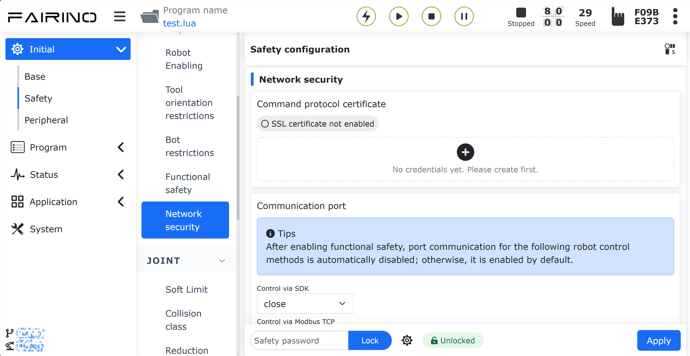

.. centered:: Abbildung 7.3-14 Konfigurationsseite für das Befehlprotokollzertifikat

Klicken Sie auf die Schaltfläche „Noch kein Zertifikat, bitte zuerst erstellen“ und geben Sie die Anzahl der gültigen Tage für das Befehlprotokollzertifikat ab dem aktuellen Tag ein. Klicken Sie auf die Schaltfläche „Erstellen“. Nach erfolgreicher Erstellung des Zertifikats werden der Name des Client-Zertifikats, die Seriennummer und das auf Basis der gültigen Tage berechnete Ablaufdatum angezeigt.

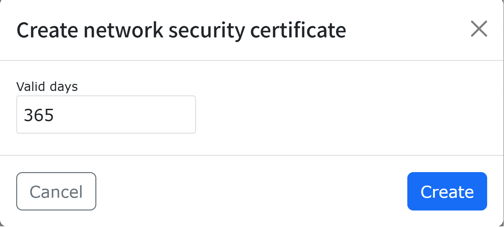

.. centered:: Abbildung 7.3-15 Konfiguration der Gültigkeitsdauer des Befehlprotokollzertifikats

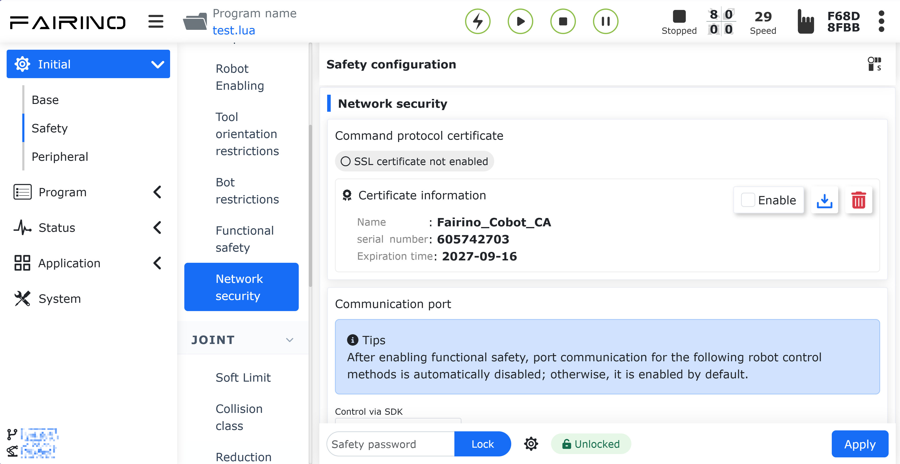

.. centered:: Abbildung 7.3-16 Informationen zum Befehlprotokollzertifikat

Klicken Sie auf die Download-Schaltfläche rechts, um das Archiv „client_certs.tar.gz“ herunterzuladen. Das Archiv enthält drei Dateien: „ca.crt“: Stammzertifikat; „client.crt“: Client-Zertifikat; „client.key“: Client-Schlüssel.

Klicken Sie auf „Aktivieren“ und dann auf die Schaltfläche „Übernehmen“. Bestätigen Sie im angezeigten Bestätigungsfenster für die Robotersicherheitskonfiguration die Aktivierung der Befehlprotokollzertifikatverschlüsselung und klicken Sie erneut auf die Schaltfläche „Bestätigen“, um die Befehlprotokollverschlüsselung zu aktivieren.

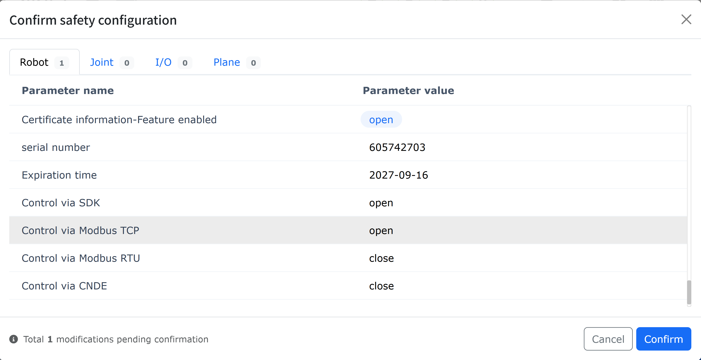

.. centered:: Abbildung 7.3-17 Bestätigung der Aktivierung des Befehlprotokollzertifikats

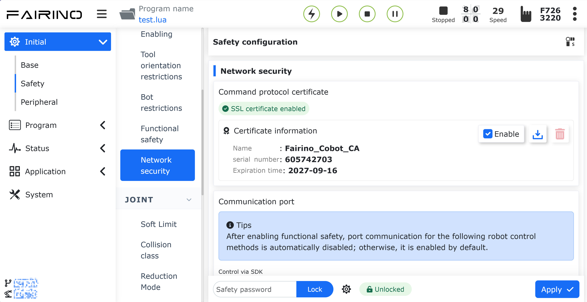

.. centered:: Abbildung 7.3-18 Befehlprotokollzertifikatverschlüsselung aktiviert

Klicken Sie auf die Schaltfläche „Löschen“ auf der rechten Seite des Zertifikatsinformationsfelds, um das Zertifikat mit der entsprechenden Seriennummer zu deaktivieren. Vor dem Löschen des Zertifikats muss die Befehlprotokollverschlüsselung zunächst auf deaktiviert gesetzt werden.

Konfiguration der Aktivierung nicht verschlüsselter Netzwerkkommunikationsfunktionen
++++++++++++++++++++++++++++++++++++++++++++++++++++++++++++++++++++++++++++++++++++++++++++

Einige unverschlüsselte Netzwerkkommunikationsfunktionen des Roboters können als aktiviert oder deaktiviert konfiguriert werden; standardmäßig sind sie deaktiviert.

.. note:: Hinweis: Die Funktion zum Deaktivieren der Kommunikationsanschlüsse des Roboters wirkt nur, wenn "Funktionale Sicherheit" aktiviert ist. Im Nicht-"Funktionale Sicherheit"-Modus sind alle Netzwerkkommunikationsfunktionen des Roboters aktiviert!

Klicken Sie in der Roboter-WebApp nacheinander auf "Grundeinstellungen", "Sicherheit" und "Netzwerksicherheit" und suchen Sie dann "Kommunikationsanschlüsse". Die Funktionen der einzelnen Anschlüsse sind wie folgt beschrieben:

.. centered:: Abbildung 7.3-19 Konfiguration der Aktivierung der Kommunikationsports

- **Steuerung über SDK**: Steuern Sie den Roboter über den XMLRPC-Kommunikationsport im Roboter-SDK. Wenn nicht aktiviert, kann der Roboter nicht über XMLRPC gesteuert werden.
- **Steuerung über ModbusTCP**: Wenn der Roboter als ModbusTCP-Slave fungiert, können der DO-Ausgang des Roboters, Programmstart/-stopp, Hand-/Auto-Umschaltung, reduzierter Modus usw. über „Funktionaler Digitaleingang (Spule)“ gesteuert werden. Nach Deaktivierung von „Steuerung über ModbusTCP“ sind die oben genannten Steuerungsfunktionen über „Funktionaler Digitaleingang (Spule)“ alle deaktiviert.
- **Steuerung über ModbusRTU**: Wenn der Roboter als ModbusRTU-Slave fungiert, können der DO-Ausgang des Roboters, Programmstart/-stopp, Hand-/Auto-Umschaltung, reduzierter Modus usw. über „Funktionaler Digitaleingang (Spule)“ gesteuert werden. Nach Deaktivierung von „Steuerung über ModbusRTU“ sind die oben genannten Steuerungsfunktionen über „Funktionaler Digitaleingang (Spule)“ alle deaktiviert.
- **Steuerung über CNDE**: Der CNDE-Eingang des Roboters kann für DO-Ausgang, AO-Ausgang, Laufgeschwindigkeit und andere Steuerungen des Roboters konfiguriert werden. Nach Deaktivierung von „Steuerung über CNDE“ kann der CNDE-Client die oben genannten Funktionen nicht steuern.
- **IP-Reset-Funktion der Tasterbox**: Die Tasterbox des Roboters V2.0 verfügt über eine IP-Reset-Taste. Wenn die „IP-Reset-Funktion der Tasterbox“ deaktiviert ist, kann die Roboter-IP nicht über die Tasterbox zurückgesetzt werden.

Geben Sie das Sicherheitskennwort auf der Sicherheitskonfigurationsseite ein und entsperren Sie es, stellen Sie die zu aktivierenden Kommunikationsports auf „Ein“, klicken Sie auf „Übernehmen“, bestätigen Sie die aktivierten Funktionen im angezeigten Bestätigungsfenster für die Sicherheitskonfiguration und klicken Sie auf die Schaltfläche „Bestätigen“.

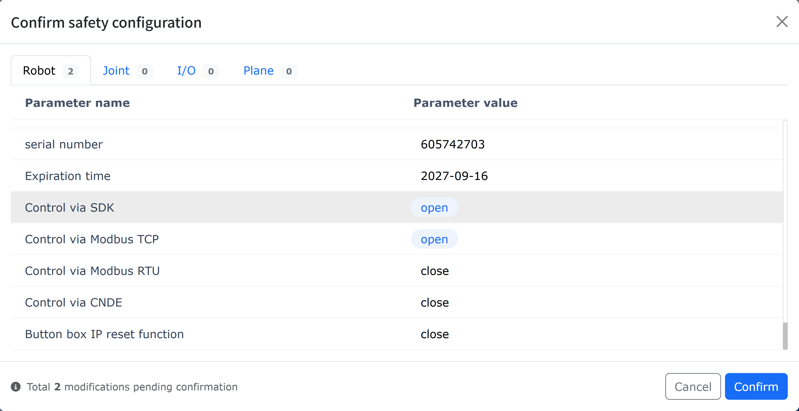

.. centered:: Abbildung 7.3-20 Bestätigung der Aktivierung der Kommunikationsports

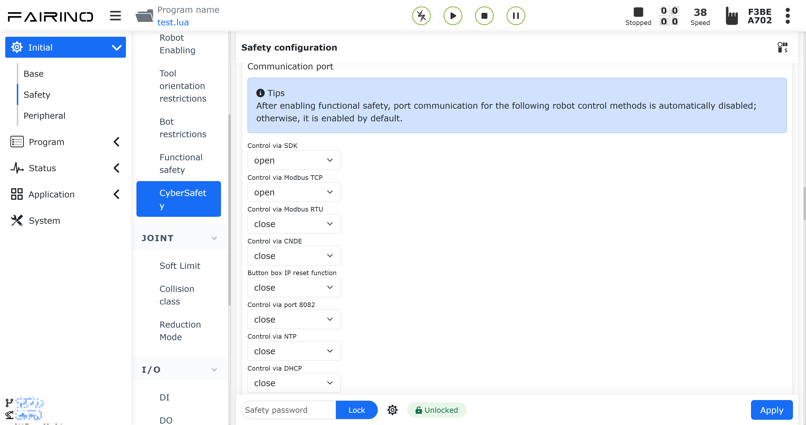

.. centered:: Abbildung 7.3-21 Kommunikationsports aktiviert

Integritätsprüfung der Robotersoftware
+++++++++++++++++++++++++++++++++++++++++++++++++++++++++++++++++++++

Beim Software-Upgrade und Software-Start des Roboters wird eine Integritätsprüfung des Softwarepakets durchgeführt, um zu verhindern, dass das Robotersoftwarepaket manipuliert wird.

Integritätsprüfung beim Software-Upgrade des Roboters: Während des Software-Upgrades des Roboters wird die Integrität des zu aktualisierenden Softwarepakets überprüft. Wenn das Softwarepaket unvollständig ist, wird während des Upgrades eine Fehlermeldung ausgegeben und das Upgrade gestoppt.

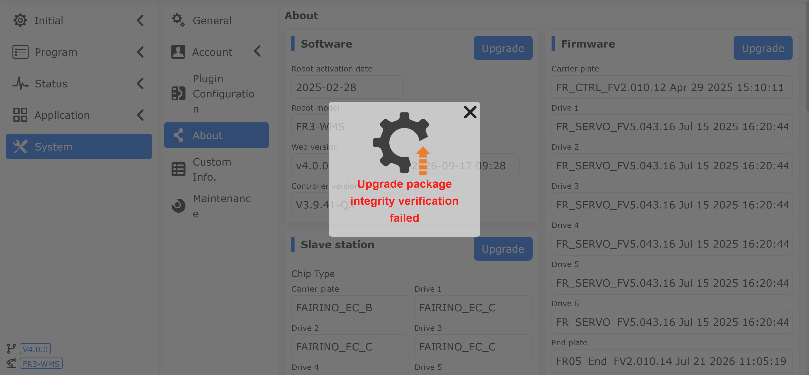

.. centered:: Abbildung 7.3-22 Fehler bei der Integritätsprüfung des Software-Upgrades

Integritätsprüfung beim Software-Start des Roboters: Während des Software-Starts des Roboters wird die Integrität des Softwarepakets im aktuellen System überprüft. Wenn das Softwarepaket vollständig ist, startet die Robotersoftware normal; andernfalls startet die Robotersoftware nicht, und in der WebApp wird eine Fehlermeldung angezeigt.

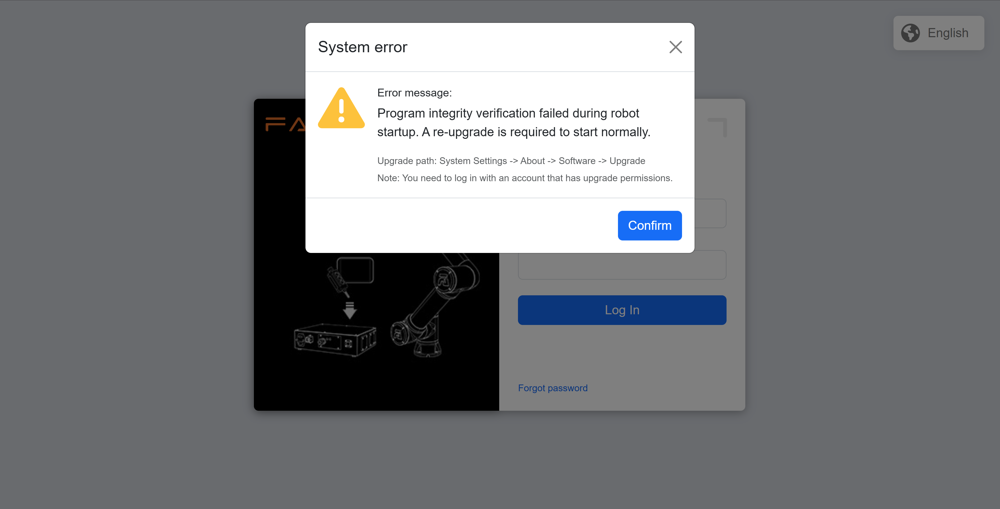

.. centered:: Abbildung 7.3-23 Fehler bei der Integritätsprüfung während des Software-Starts

Erklärung zu Restrisiken der Cybersicherheit
+++++++++++++++++++++++++++++++++++++++++++++++++++++++++++++++++++++

.. centered:: Tabelle 2-1 Restrisiken der Cybersicherheit und kompensierende Maßnahmen des Benutzers

.. list-table::
   :widths: 10 20 25 45
   :header-rows: 0
   :align: center

   * - **Nr.**
     - **Restrisiko**
     - **Ergriffene Minderungsmaßnahmen**
     - **Kompensierende Maßnahmen des Benutzers**

   * - 1
     - Das SDK-XMLRPC-Kommunikationsprotokoll des Roboters wird im Klartext übertragen
     - | ① Die SDK-Steuerungsfunktion des Roboters ist standardmäßig deaktiviert;
       | ② Das SDK integriert von Natur aus die Befehlprotokolle 8080-TCP und 20007-UDP, und die Befehlprotokolle verfügen über TLS 1.2-Verschlüsselung; wenn der Verschlüsselungshandshake des Befehlprotokolls fehlschlägt, kann das SDK keine normale Verbindung zum Roboter herstellen.
     - | ① Die SDK-Kommunikation zwischen dem Host-Computer und dem Roboter darf nur in einer vertrauenswürdigen isolierten Netzwerkumgebung bereitgestellt werden; der Anschluss an nicht vertrauenswürdige Netzwerke ist nicht zulässig; Netzwerkverbindungen und Netzwerkports müssen physisch geschützt werden, um unbefugten Zugriff zu verhindern;
       | ② Das SDK integriert die 20007-UDP-Befehlprotokollkommunikation und bietet die SendUDPFrame()-Schnittstelle zum Senden benutzerdefinierter Befehlframes. Gleichzeitig verfügt die 20007-UDP-Befehlprotokollkommunikation über DTLS-Verschlüsselung. Sensible Informationen müssen über diese Schnittstelle an den Roboter gesendet werden;
       | ③ Wenn nicht erforderlich, deaktivieren Sie die SDK-Steuerungsfunktion des Roboters in den WebApp-Modulen „Sicherheit“ und „Cybersicherheit“;

   * - 2
     - Die konfigurierbare Datenaustausch-CNDE-Kommunikation 20005 - TCP / 20006 - UDP des Roboters wird im Klartext übertragen
     - | ① Die CNDE-Steuerungsfunktion des Roboters ist standardmäßig deaktiviert;
     - | ① Die CNDE-Kommunikation zwischen dem Host-Computer und dem Roboter darf nur in einer vertrauenswürdigen isolierten Netzwerkumgebung bereitgestellt werden; der Anschluss an nicht vertrauenswürdige Netzwerke ist nicht zulässig; Netzwerkverbindungen und Netzwerkports müssen physisch geschützt werden, um unbefugten Zugriff zu verhindern;
       | ② Wenn nicht erforderlich, deaktivieren Sie die CNDE-Steuerungsfunktion des Roboters in den WebApp-Modulen „Sicherheit“ und „Cybersicherheit“;

   * - 3
     - Die ModbusTCP-Kommunikation des Roboters wird im Klartext übertragen
     - | ① Die ModbusTCP-Steuerungsfunktion des Roboters ist standardmäßig deaktiviert;
     - | ① Die ModbusTCP-Kommunikation zwischen dem Host-Computer und dem Roboter darf nur in einer vertrauenswürdigen isolierten Netzwerkumgebung bereitgestellt werden; der Anschluss an nicht vertrauenswürdige Netzwerke ist nicht zulässig; Netzwerkverbindungen und Netzwerkports müssen physisch geschützt werden, um unbefugten Zugriff zu verhindern;
       | ② Wenn nicht erforderlich, deaktivieren Sie die ModbusTCP-Steuerungsfunktion des Roboters in den WebApp-Modulen „Sicherheit“ und „Cybersicherheit“;

   * - 4
     - Die ModbusRTU-Kommunikation des Roboters wird im Klartext übertragen
     - | ① Die ModbusRTU-Steuerungsfunktion des Roboters ist standardmäßig deaktiviert;
     - | ① Die ModbusRTU-Kommunikation zwischen dem Host-Computer und dem Roboter darf nur in einer vertrauenswürdigen isolierten Netzwerkumgebung bereitgestellt werden; der Anschluss an nicht vertrauenswürdige Netzwerke ist nicht zulässig; Netzwerkverbindungen und Netzwerkports müssen physisch geschützt werden, um unbefugten Zugriff zu verhindern;
       | ② Wenn nicht erforderlich, deaktivieren Sie die ModbusRTU-Steuerungsfunktion des Roboters in den WebApp-Modulen „Sicherheit“ und „Cybersicherheit“;

   * - 5
     - Angreifer könnten das Standard-WebApp-Administrator-Anmeldekonto und -Kennwort verwenden, um die Sicherheitskonfigurationsparameter des Roboters zu ändern
     - Nein
     - | ① Benutzer müssen das Standard-Administrator-Anmeldekennwort der Roboter-WebApp ändern und das Kennwort ordnungsgemäß aufbewahren;
       | ② Benutzer müssen entsprechende WebApp-Anmeldekonten und -Kennwörter für Personal mit unterschiedlichen Sicherheitskonfigurationsberechtigungen einrichten und die Kennwörter ordnungsgemäß aufbewahren;

   * - 6
     - Angreifer könnten das Standard-WebApp-Anmeldekonto und -Kennwort verwenden, um die Software-/Firmware-Version des Roboters zu ändern
     - Nein
     - | ① Benutzer müssen das Standard-Administrator-Anmeldekennwort der Roboter-WebApp ändern und das Kennwort ordnungsgemäß aufbewahren;
       | ② Benutzer müssen entsprechende WebApp-Anmeldekonten und -Kennwörter für Personal mit unterschiedlichen Software-/Firmware-Aktualisierungsberechtigungen einrichten und die Kennwörter ordnungsgemäß aufbewahren;

   * - 7
     - Angreifer könnten das Standard-Sicherheitskennwort verwenden, um Sicherheitskonfigurationsparameter zu ändern
     - Nein
     - | ① Benutzer müssen das Robotersicherheitskennwort ändern; die Verwendung des Standard-Sicherheitskennworts ist verboten;

   * - 8
     - Angreifer könnten die LAN1 / LAN2-Ethernet-Ports des Roboters physisch beschädigen und so die Ethernet-Kommunikation des Roboters lahmlegen
     - Keine
     - | ① Benutzer müssen den Roboter-Steuerschrank in einem Schaltschrank mit Verriegelungsvorrichtung installieren und unbefugtem Personal den Zugang zum Roboter-Steuerschrank verbieten;

   * - 9
     - Angreifer könnten den RS-485-Kommunikationsport des Roboters physisch beschädigen und so die Erweiterungsachsensteuerung und die ModbusRTU-Kommunikation des Roboters lahmlegen
     - Keine
     - | ① Benutzer müssen den Roboter-Steuerschrank in einem Schaltschrank mit Verriegelungsvorrichtung installieren und unbefugtem Personal den Zugang zum Roboter-Steuerschrank verbieten;

   * - 10
     - Angreifer könnten die Not-Halt-Taste an der Roboter-Tasterbox physisch beschädigen und so die Not-Halt-Taste des Roboters lahmlegen
     - Keine
     - | ① Benutzer müssen die Roboter-Tasterbox in einem sicheren Arbeitsbereich aufstellen und unbefugtem Personal den Zutritt zu diesem Bereich verbieten;

   * - 11
     - Angreifer könnten die Not-Halt-Taste am Roboter-Teach-Pendant physisch beschädigen und so die Not-Halt-Taste des Roboters lahmlegen
     - Keine
     - | ① Benutzer müssen das Roboter-Teach-Pendant in einem sicheren Arbeitsbereich aufstellen und unbefugtem Personal den Zutritt zu diesem Bereich verbieten;

Sicherheitskonfigurationsparameter
--------------------------------------------------------------------------------------------------

Sicherheitsparameter des Roboters
~~~~~~~~~~~~~~~~~~~~~~~~~~~~~~~~~~~~~~~~~~~~~~~~~~~~~~~~~~~~~~~~~~~~~~~

Robotergeschwindigkeit
++++++++++++++++++++++++++++++++++++++++++++++++++++++++++++++

Klicken Sie in der Menüleiste auf "Grundeinstellungen" -> "Sicherheit" und klicken Sie auf das Untermenü "Robotergeschwindigkeit", um zur Konfigurationsoberfläche zu gelangen.

Die Robotergeschwindigkeit wird verwendet, um die maximale Lineargeschwindigkeit, die Linearbeschleunigung und die Gelenkwinkelbeschleunigung des Roboters zu begrenzen.

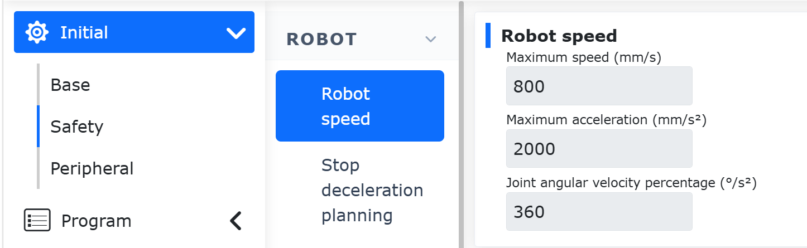

.. centered:: Abbildung 7.4-1 Robotergeschwindigkeit
 
Stopp-Verzögerungsplanung
++++++++++++++++++++++++++++++++++++++++++++++++++++++++++++++

Klicken Sie in der Menüleiste auf "Grundeinstellungen" -> "Sicherheit" und klicken Sie auf das Untermenü "Stopp-Verzögerungsplanung", um zur Konfigurationsoberfläche zu gelangen.

- Freier Stopp: Beim Stoppvorgang wird die Winkelgeschwindigkeit jeder Achse gemäß dem eingestellten Stopp-Verzögerungsprozentsatz multipliziert mit der maximalen Gelenkbeschleunigung abgebremst und gestoppt;
- Synchronisierter Stopp: Beim Stoppvorgang wird die TCP-Posengeschwindigkeit gemäß dem eingestellten Stopp-Verzögerungsprozentsatz multipliziert mit der maximalen Posenbeschleunigung abgebremst und gestoppt;

Die Stoppverzögerung ist ein Prozentsatz der Beschleunigung.

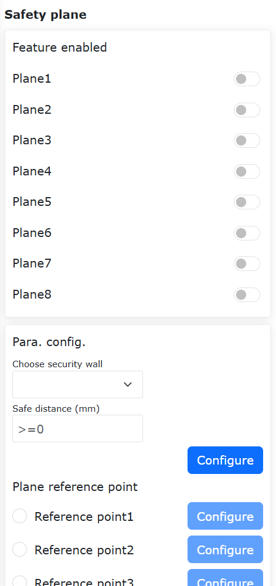

.. centered:: Abbildung 7.4-2 Robot-Stopp-Verzögerungsplanung

Sicherheitsstopp
++++++++++++++++++++++++++++++++++++++++++++++++++++++++++++++

Klicken Sie in der Menüleiste auf "Grundeinstellungen" -> "Sicherheit" und klicken Sie auf "Sicherheitsstopp", um zur Konfigurationsoberfläche zu gelangen, um den Sicherheitsstoppmodus und die Sicherheitsstopp-Strategieparameter einzustellen.

Wenn der Auslösemodus des Sicherheitsstopps auf "Zweikanal" eingestellt ist, müssen beide Kanäle gelöscht werden und die Warnung muss manuell auf der Bedienoberfläche gelöscht werden, bevor der Roboter zurückgesetzt werden kann. Darüber hinaus wurde eine Option für den reduzierten Modus in der Strategiekonfiguration hinzugefügt. Wenn der Benutzer diese Strategie auswählt, wird der Roboter in den reduzierten Modus versetzt.

**Schritt 1**: Klicken Sie auf "Grundeinstellungen" -> "Sicherheit" -> "Sicherheitsstopp". Der Auslösemodus kann als "Standard" oder "Zweikanal" ausgewählt werden. Der Unterschied zwischen den beiden besteht darin: Im "Standard"-Modus wird der Fehler auf der Oberfläche nach der Auslösung und Wiederherstellung automatisch gelöscht; im "Zweikanal"-Modus muss der Fehler auf der Oberfläche nach der Auslösung und Wiederherstellung manuell gelöscht werden. "Sicherheitsstopp-Strategie" kann als "Stopp", "Pause", "Reduzierter Modus Stufe 1" und "Reduzierter Modus Stufe 2" ausgewählt werden. Die detaillierten Beschreibungen lauten wie folgt: Wenn "Stopp" ausgewählt ist, stoppt der Roboter die aktuelle Bewegung; wenn "Pause" ausgewählt ist, pausiert der Roboter die aktuelle Bewegung, und nach der Wiederherstellung und Fehlerlöschung wird die Pause fortgesetzt; wenn "Reduzierter Modus Stufe 1" ausgewählt ist, wechselt der Roboter in den reduzierten Modus Stufe 1; wenn "Reduzierter Modus Stufe 2" ausgewählt ist, wechselt der Roboter in den reduzierten Modus Stufe 2.

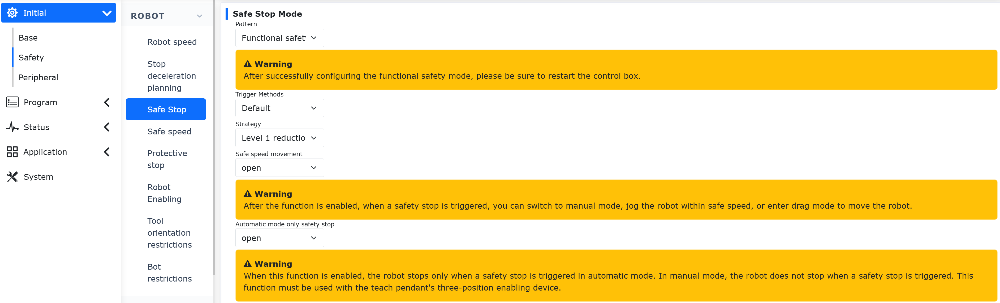

.. centered:: Abbildung 7.4-3 Robot-Stopp-Verzögerungsplanung

**Schritt 2**: Wenn der Auslösemodus auf "Standard" eingestellt ist, kann der Fehler auf der Oberfläche nach der Auslösungswiederherstellung automatisch gelöscht werden. Wenn der Auslösemodus auf "Zweikanal" eingestellt ist, lautet der Vorgang: Nach der Auslösungswiederherstellung klicken Sie manuell auf "Löschen" in der oberen rechten Ecke, um den Roboter zurückzusetzen.

Sicherheitsgeschwindigkeit
++++++++++++++++++++++++++++++++++++++++++++++++++++++++++++++

Klicken Sie in der Menüleiste auf "Grundeinstellungen" -> "Sicherheit" und klicken Sie auf "Sicherheitsgeschwindigkeit", um zur Konfigurationsoberfläche zu gelangen, um die Sicherheitsgeschwindigkeit einzustellen. Der manuelle TCP-Geschwindigkeitsbereich beträgt 1-1500mm/s.

Die Sicherheitsgeschwindigkeitsfunktion des Roboters wird in kollaborativen oder dynamischen Umgebungen eingesetzt, um die Betriebsgeschwindigkeit des Roboters aktiv zu begrenzen und kinetische Energie und Aufprallkraft innerhalb von Sicherheitsschwellenwerten zu halten, um so Personenschäden bei versehentlichem Kontakt zu verhindern und Geräte und Werkstücke effektiv vor Kollisionsschäden zu schützen.

**Schritt 1**: Klicken Sie auf "Grundeinstellungen" -> "Sicherheit" -> "Sicherheitsgeschwindigkeit", um die Sicherheitsgeschwindigkeitsparameter einzustellen, die hauptsächlich drei Teile umfassen: "Funktionsaktivierung", "Geschwindigkeitsbegrenzung" und "Modus nach Geschwindigkeitsüberschreitung".

Dabei kann Funktionsaktivierung als "Deaktivieren", "Im Handmodus aktivieren" und "In allen Modi aktivieren" ausgewählt werden;

Bei Geschwindigkeitsbegrenzung wird die Geschwindigkeitsbegrenzung eingestellt. Wenn die lineare Geschwindigkeit des Roboters diese Grenze erreicht, wird sie gemäß den in "Modus nach Geschwindigkeitsüberschreitung" eingestellten Parametern verarbeitet. "Modus nach Geschwindigkeitsüberschreitung" kann als "Stopp mit Alarm", "Automatische Geschwindigkeitsbegrenzung" und "Nach Stopp mit Alarm deaktivieren" ausgewählt werden. Die automatische Geschwindigkeitsbegrenzung ist nur im "Handmodus aktivieren" verfügbar.

Nach dem Einstellen der erforderlichen Parameter sind keine weiteren Aktionen erforderlich. Die Bewegung des Roboters wird gemäß den eingestellten Parametern verarbeitet. Die Parametereinstellungen sind in der Abbildung dargestellt.

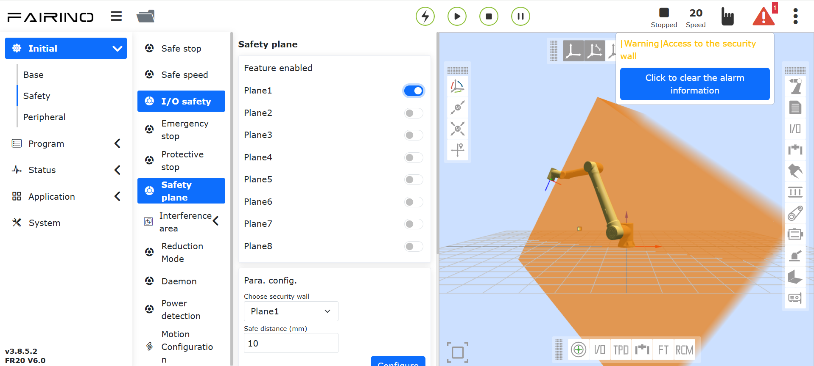

.. centered:: Abbildung 7.4-4 Einstellungen der Sicherheitsgeschwindigkeitsparameter

Not-Halt
++++++++++++++++++++++++++++++++++++++++++++++++++++++++++++++

Klicken Sie in der Menüleiste auf "Grundeinstellungen" -> "Sicherheit" und klicken Sie auf "Not-Halt", um zur Konfigurationsoberfläche zu gelangen.

Die Not-Halt-Typen 0, 1a, 1b, 2 können eingestellt werden, das Stoppzeitlimit kann eingestellt werden und das Stoppdistanzlimit kann eingestellt werden.

Über die Steuerung, die an die Steuerschrankplatine sendet, unterbricht der Not-Halt Typ 0 direkt die Stromversorgung der Steuerschrankplatine;

- Not-Halt Typ 1a: Nach dem Abbremsen wird die Stromversorgung des Roboterkörpers unterbrochen;
- Not-Halt Typ 1b: Nach dem Abbremsen wird die Stromversorgung des Roboterkörpers nicht unterbrochen, aber der Roboter wird deaktiviert;
- Not-Halt Typ 2: Wenn der Not-Halt betätigt wird, bremst der Roboter ab und bleibt aktiviert. Nach dem Lösen des Not-Halts sollte der Roboter normal funktionieren.

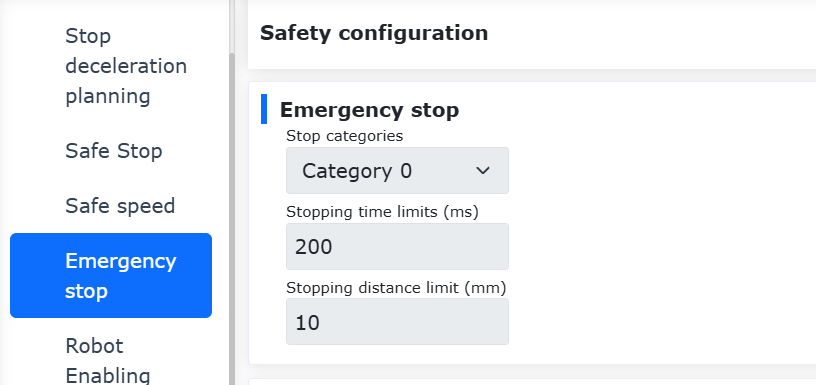

.. centered:: Abbildung 7.4-5 Not-Halt-Einstellungen

Schutzstopp
++++++++++++++++++++++++++++++++++++++++++++++++++++++++++++++

Klicken Sie in der Menüleiste auf "Grundeinstellungen" -> "Sicherheit" und klicken Sie auf das Untermenü "Schutzstopp", um zur Konfigurationsoberfläche zu gelangen.

Schutzstopp-Typen 0, 1, 2. Schutzstopp Typ 0 unterbricht direkt die Stromversorgung der Steuerschrankplatine. Schutzstopp Typ 1: Die Steuerschrankplatine benachrichtigt zuerst die Steuerung, um den Roboter zu stoppen, dann gibt die Steuerung eine Rückmeldung an die Steuerschrankplatine, um die Stromversorgung zu unterbrechen. Schutzstopp Typ 2: Die Steuerschrankplatine benachrichtigt die Steuerung, um den Roboter zu stoppen.

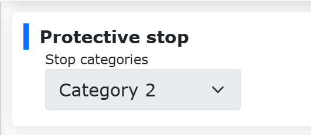

.. centered:: Abbildung 7.4-6 Schutzstopp-Konfiguration

Automatische Aktivierung beim Einschalten
++++++++++++++++++++++++++++++++++++++++++++++++++++++++++++++

Klicken Sie in der Menüleiste auf "Grundeinstellungen" -> "Sicherheit" und klicken Sie auf das Untermenü "Roboteraktivierung", um zur Konfigurationsoberfläche zu gelangen. Sie können wählen, ob der Roboter beim Einschalten automatisch aktiviert wird oder nicht.

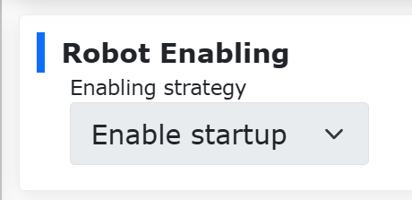

.. centered:: Abbildung 7.4-7 Automatische Aktivierung beim Einschalten

Werkzeugorientierungsbegrenzung (Nur im LA-System verwendet)
++++++++++++++++++++++++++++++++++++++++++++++++++++++++++++++

Klicken Sie in der Menüleiste auf "Grundeinstellungen" -> "Sicherheit" und klicken Sie auf das Untermenü "Werkzeugorientierungsbegrenzung", um zur Konfigurationsoberfläche zu gelangen.

Die Werkzeugorientierungsbegrenzung ist eine Schutzfunktion, die im kartesischen Raum des Werkzeugendes des Roboters wirkt, um den Bewegungsumfang der Endpose des Roboters zu begrenzen. Sie umfasst die Aktivierungseinstellung der Funktion, die Einstellung der Referenzwerkzeugrichtung und die Einstellung des maximalen Abweichungswinkels. Der maximale Abweichungswinkel definiert den maximalen Winkelgrenzwert zwischen der Z-Achse des kartesischen Koordinatensystems des Werkzeugendes und der Referenzwerkzeugrichtung, der normalerweise als konischer Raum verstanden werden kann.

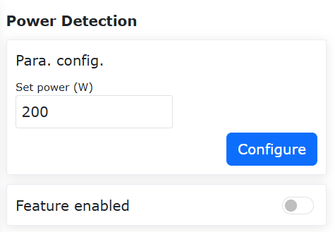

.. centered:: Abbildung 7.4-8 Werkzeugorientierungsbegrenzung

Roboterbegrenzungen (Nur im LA-System verwendet)
++++++++++++++++++++++++++++++++++++++++++++++++++++++++++++++

Klicken Sie in der Menüleiste auf "Grundeinstellungen" -> "Sicherheit" und klicken Sie auf das Untermenü "Roboterbegrenzungen", um zur Konfigurationsoberfläche zu gelangen.

Die Roboterbegrenzungen umfassen Impuls und Leistung, wobei die Impulsbegrenzung zur Begrenzung des maximalen Impulses des Roboters verwendet wird und die Leistungsbegrenzung zur Begrenzung der vom Roboter geleisteten mechanischen Arbeit.

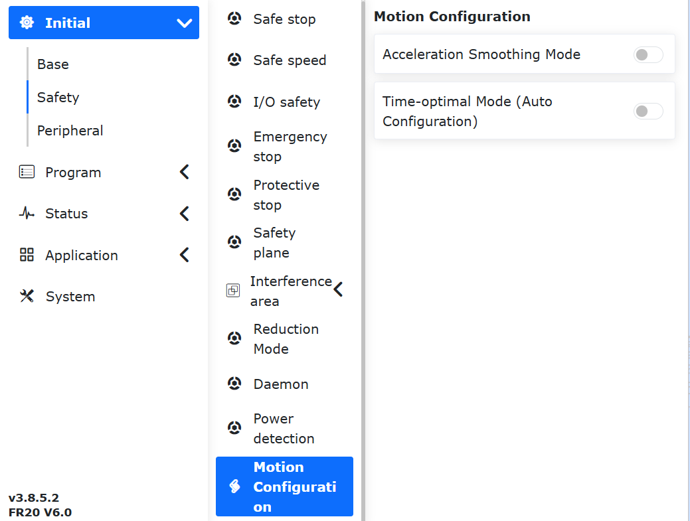

.. centered:: Abbildung 7.4-9 Roboterbegrenzungen

Gelenke
~~~~~~~~~~~~~~~~~~~~~~~~~~~~~~~~~~~~~~~~~~~~~

Weiche Gelenkbegrenzungen
++++++++++++++++++++++++++++++++++++++++++++++++++++++++++++++

Klicken Sie in der Menüleiste auf "Grundeinstellungen" -> "Sicherheit" -> "Gelenke" und klicken Sie auf "Weiche Gelenkbegrenzungen", um zur Oberfläche für weiche Begrenzungen zu gelangen.

Im Bewegungsbereich des Roboters können sich andere Geräte befinden. Die Begrenzungswinkel können eine weiche Begrenzung des Roboters durchführen, um zu verhindern, dass der Roboter über bestimmte Koordinatenwerte hinausfährt und um Kollisionen zu vermeiden. Das Auslösen einer weichen Begrenzung führt zu einem automatischen Stopp des Roboters, ohne Stoppdistanz.

Administratoren können Standardwerte verwenden oder Winkelwerte eingeben. Durch die Eingabe von Winkelwerten können die positiven und negativen Winkel der Robotergelenke separat begrenzt werden. Wenn der eingegebene Wert die in der Tabelle der robotergrundparameter in Abschnitt 2.1-Grundparameter aufgeführten weichen Gelenkbegrenzungswinkel überschreitet, wird der Begrenzungswinkel auf den maximal einstellbaren Wert angepasst. Wenn der Roboter einen Gelenkbefehl-Überschreitungsfehler meldet, muss in den Ziehmodus gewechselt werden, um das Robotergelenk wieder innerhalb des Begrenzungswinkels zu ziehen.

Die Schutzfunktion der weichen Gelenkbegrenzung ist ein aktiver Schutzmechanismus, der den Bewegungszustand der Roboterarmgelenke in Echtzeit überwacht und den Bediener dynamisch daran hindert, beim Zieh-Teach-in den eingestellten weichen Begrenzungsbereich zu überschreiten. Diese Funktion macht weiche Begrenzungen auch im Zieh-Teach-in sinnvoll und erhöht so die Sicherheit der Mensch-Roboter-Kollaboration.

- **Schritt 1**: Melden Sie sich an der Weboberfläche an und klicken Sie nacheinander auf "Grundeinstellungen" -> "Sicherheit" -> "Gelenke" -> "Weiche Gelenkbegrenzungen", um zum Einstellungsmodul für weiche Roboterbegrenzungen zu gelangen.
- **Schritt 2**: Legen Sie basierend auf dem tatsächlichen Arbeitsbereich des Roboters die weichen Begrenzungen für jedes Gelenk sinnvoll fest. Überprüfen Sie zu diesem Zeitpunkt, ob sich die aktuelle Winkelposition jedes Robotergelenks innerhalb des voreingestellten weichen Begrenzungsbereichs befindet. Wenn ja, klicken Sie auf "Übernehmen", um die voreingestellten weichen Begrenzungen zu senden. Wenn nicht, bewegen Sie jedes Gelenk in den voreingestellten Bereich; andernfalls wird beim Klicken auf "Übernehmen" eine Überschreitungsmeldung angezeigt, wie in der folgenden Abbildung dargestellt. Zu diesem Zeitpunkt können Sie das über das Limit hinausgehende Gelenk in Richtung des weichen Begrenzungsbereichs tippen oder ziehen, um den Fehler zu beheben.
- **Schritt 3**: Nachdem der weiche Begrenzungsbereich erfolgreich eingestellt wurde, wählen Sie "Aktivieren" für "Schutz der weichen Gelenkbegrenzung", um diese Funktion zu aktivieren, wie in der folgenden Abbildung dargestellt. Im Ziehmodus werden die eingestellten weichen Begrenzungen wirksam, und beim Ziehen in der Nähe der weichen Begrenzungen ist ein Widerstand spürbar.
- **Schritt 4**: Um die Schutzfunktion der weichen Gelenkbegrenzung zu deaktivieren, klicken Sie auf "Schutz der weichen Gelenkbegrenzung", um sie auszuschalten.

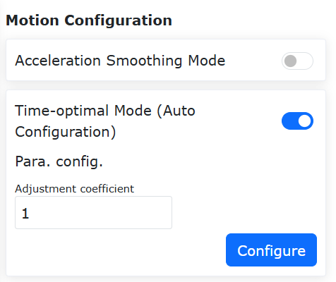

.. centered:: Abbildung 7.4-10 Weiche Gelenkbegrenzungen

Kollisionsstufe
++++++++++++++++++++++++++++++++++++++++++++++++++++++++++++++

Klicken Sie in der Menüleiste auf "Grundeinstellungen" -> "Sicherheit" -> "Gelenke" und klicken Sie auf "Kollisionsstufe", um zur Oberfläche der Kollisionsstufe zu gelangen.
Die Kollisionsstufen sind in Stufen 1 bis 10 unterteilt. Die Stufen 1 bis 3 sind empfindlicher, und der Roboter muss mit der empfohlenen Geschwindigkeit laufen. Sie können auch benutzerdefinierte Prozenteinstellungen wählen, wobei 100 % Stufe 10 entspricht. Wie in der folgenden Abbildung dargestellt:

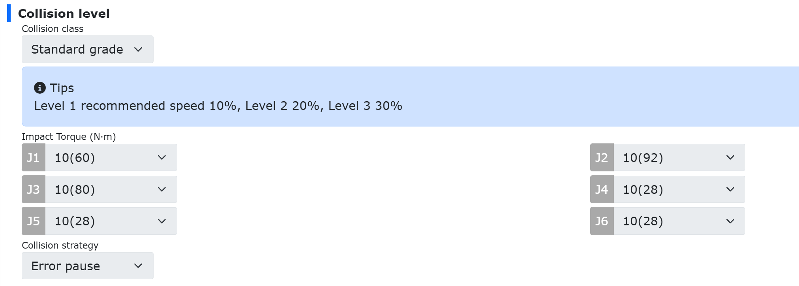

.. centered:: Abbildung 7.4-11 Kollisionsstufendiagramm

Die Kollisionsstrategien sind "Stopp bei Kollision", "Pause bei Kollision" und "Bewegung fortsetzen". Um eine Druckkraft zwischen Roboter und Objekten nach einer Kollision zu vermeiden, wurden die Strategien "Schwerkraftmomentmodus", "Schwingungsantwortmodus" und "Kollisionsrückprallmodus" hinzugefügt. Bei Auslösung wechseln alle drei Strategien vom Automatik- oder Handmodus in den Ziehmodus und dann zurück in den Handmodus. Der Schwerkraftmomentmodus bewegt sich basierend auf der Größe und Richtung der Kollisionskraft vom Kollisionspunkt weg; der Schwingungsantwortmodus kehrt nach dem Verlassen des Kollisionspunkts zur Kollisionsposition zurück; der Kollisionsrückprallmodus beschleunigt gemäß den eingestellten Parametern vom Kollisionspunkt weg.

Klicken Sie im Abschnitt "Kollisionsstrategie" auf das Dropdown-Menü und wählen Sie "Kollisionsrückprallmodus". Stellen Sie die Sicherheitszeit auf 1000ms, den Sicherheitsabstand auf 150mm, die Sicherheitsgeschwindigkeit auf 150mm/s und den Sicherheitsfaktor für jedes Gelenk auf 5 ein. Die spezifische Oberfläche ist in der folgenden Abbildung dargestellt.

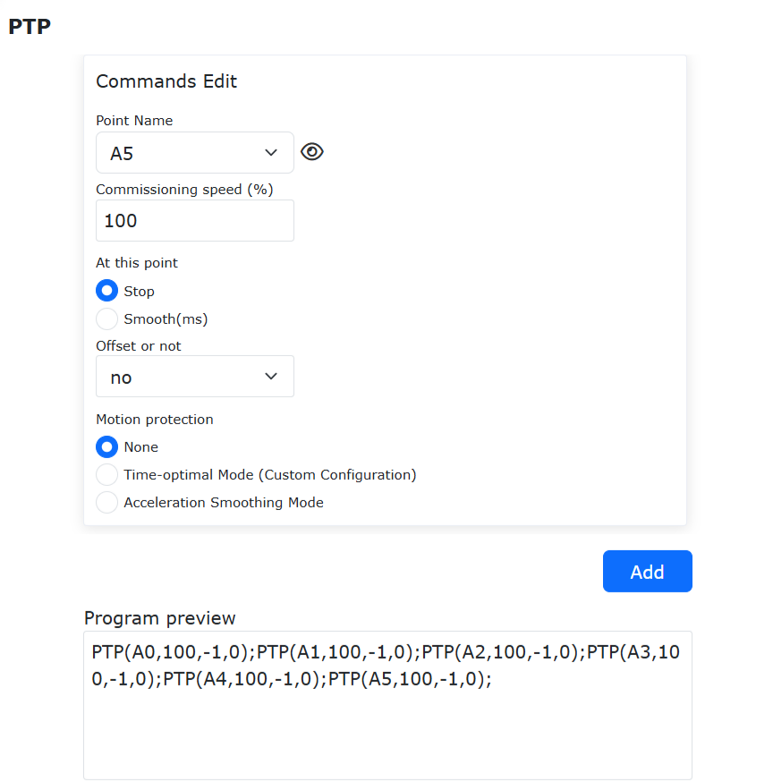

.. centered:: Abbildung 7.4-12 Kollisionsstrategie: Kollisionsrückprallmodus

Bedeutung der einzelnen Parameter:

- Sicherheitszeit: Gibt die Dauer im Ziehmodus nach dem Wechsel vom Automatikmodus in den Ziehmodus an, Bereich [1000-2000]ms;
- Sicherheitsabstand: Gibt die Position an, die der Roboter nach einer Kollision vom Kollisionspunkt entfernt, Bereich [150-200]mm;
- Sicherheitsgeschwindigkeit: Gibt die maximale TCP-Geschwindigkeit an, mit der sich der Roboter nach einer Kollision vom Kollisionspunkt entfernt. Überschreitung dieses Geschwindigkeitslimits begrenzt die Rückprallkraft, Bereich [50-250]mm/s;
- Sicherheitsfaktor: Gibt die Abklinggeschwindigkeit der Rückprallkraft an. Je kleiner der Koeffizient, desto schneller das Abklingen und desto schneller die Rückprallgeschwindigkeit; je größer der Koeffizient, desto langsamer das Abklingen. Bereich [1-10], dimensionslos.
- Bevor der Roboter in den Ziehmodus wechselt, ist eine Drehmomentprüfung erforderlich. Diese Funktion soll verhindern, dass es nach dem Wechsel des Roboters in den Ziehmodus zu abnormalen Phänomenen wie Anheben oder Absinken kommt, die durch falsche Lastparameter oder falsche Installationsmoduseinstellungen des Bedieners verursacht werden. Wenn das Gelenkmoment außerhalb des zulässigen Bereichs liegt, meldet die Steuerung sofort einen Fehler und verhindert, dass der Roboter in den Ziehmodus wechselt.

Schritte zur Aktivierung der Kollisionserkennungsfunktion für lineare Zahnstangenführungen:

- Schritt 1: Stellen Sie sicher, dass sowohl die Führung als auch der Roboter frontmontiert sind. Überprüfen Sie vor der Aktivierung der Kollisionserkennungsfunktion für lineare Zahnstangenführungen, ob die Installationsmethode frontmontiert ist. Stellen Sie konkret zuerst sicher, dass die Führung und der Roboter frontmontiert sind. Klicken Sie dann nacheinander auf "Grundeinstellungen" -> "Basis" -> "Installation", um zur Seite für die freie Installation zu gelangen. Wenn sowohl "Basisrotation" als auch "Basiskippung" 0 sind, ist die Software auf frontmontiert eingestellt; andernfalls müssen sie auf 0 geändert werden. Wenn sie nicht 0 sind, wird auf der Oberfläche ein Fehler angezeigt.
- Schritt 2: Aktivieren Sie die Kollisionserkennungsfunktion für lineare Zahnstangenführungen und stellen Sie die Parameter ein. Klicken Sie nacheinander auf "Grundeinstellungen" -> "Sicherheit" -> "Gelenke" -> "Kollisionsstufe", um zur Seite für die Kollisionsstufeneinstellung zu gelangen. Nachdem Sie auf den Schieberegler der Funktion "Kollisionserkennung für lineare Zahnstangenführungen" geklickt haben, stellen Sie den Zahnradradius und die Schlittenmasse ein. Der Zahnradradius kann aus der Steigung und dem Untersetzungsverhältnis berechnet werden. Die Schlittenmasse umfasst nicht den Roboter und seine Endlast. Es gibt 11 Führungsstufenoptionen, wobei Stufe 1 am einfachsten eine Kollision auslöst und Stufe 10 am schwierigsten ist. Wenn die Steuerung zum ersten Mal eingeschaltet wird und bevor das Anpassungsprogramm ausgeführt wird, sollte die Kollisionsstufe zuerst auf "Deaktiviert" eingestellt werden.

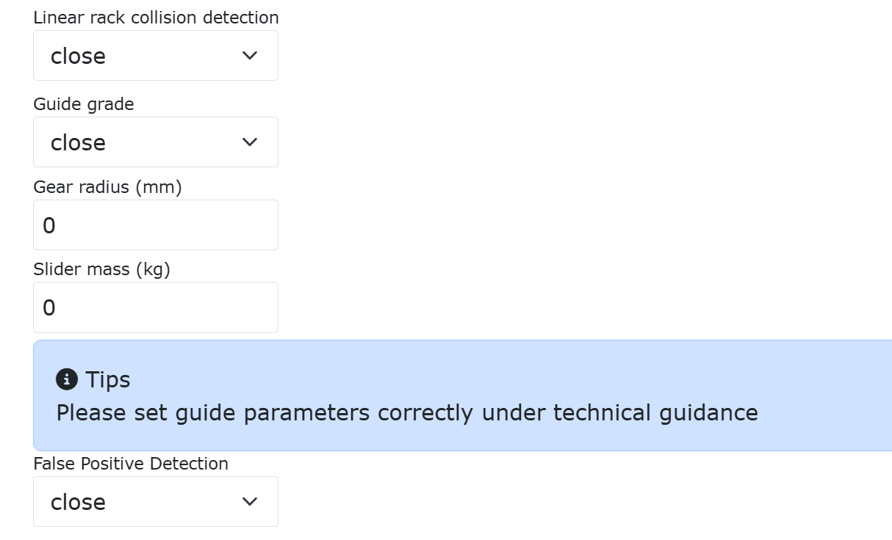

.. centered:: Abbildung 7.4-13 Kollisionserkennungsfunktion für lineare Zahnstangenführungen

- Schritt 3: Führen Sie das Programm "Rail_Adaptation_Program.lua" aus, um sich an die aktuelle Führung anzupassen. Nach jedem Neustart der Steuerung muss das Programm "Rail_Adaptation_Program.lua" ausgeführt werden (um zu verhindern, dass Änderungen am Robotertyp und andere Faktoren die dynamischen Eigenschaften der Führung beeinflussen). Stellen Sie vor der Ausführung des Programms sicher, dass die Kollisionsstufe der Führung auf "Deaktiviert" eingestellt ist. Führen Sie im Automatikmodus das LUA-Programm mit 100 % der Oberflächengeschwindigkeit aus. Nach einem Durchlauf des Programms ist die Anpassung abgeschlossen und die Ausführung kann gestoppt werden.

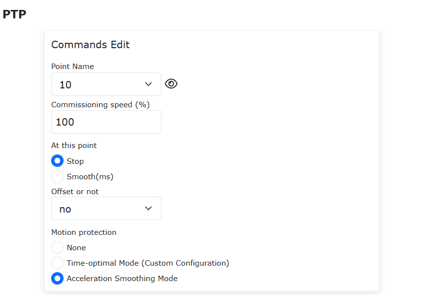

.. centered:: Abbildung 7.4-14 Ausführen von "Rail_Adaptation_Program.lua" zur Anpassung an die aktuelle Führung

- Schritt 4: Legen Sie die Kollisionsstufe der Führung sinnvoll fest und führen Sie Aufgaben aus. Benutzer können die Kollisionsstufe der Führung basierend auf der Motorantriebsleistung und der Aufgabenausführungsgeschwindigkeit sinnvoll festlegen. Wenn die Führung und der Roboter asynchron arbeiten, kann eine Kollision mit dem Roboter oder der Führung einen "8-Achsen-Kollisionsfehler, zurücksetzbar" auslösen. In diesem Fall stoppt die Führung, wie in Abbildung 2-9 dargestellt. Wenn die Führung und der Roboter synchron arbeiten, kann eine Kollision mit dem Roboter einen Alarm auslösen, der die Führung stoppt, während der Roboter gemäß der eingestellten Kollisionsstrategie reagiert.

Reduzierter Modus
++++++++++++++++++++++++++++++++++++++++++++++++++++++++++++++

Klicken Sie in der Menüleiste auf "Grundeinstellungen" -> "Sicherheit" und klicken Sie auf das Untermenü "Reduzierter Modus", um zur Konfigurationsoberfläche zu gelangen. Wählen Sie "Modus Stufe 1/Stufe 2", um die Gelenkgeschwindigkeit und die End-TCP-Geschwindigkeit zu konfigurieren.

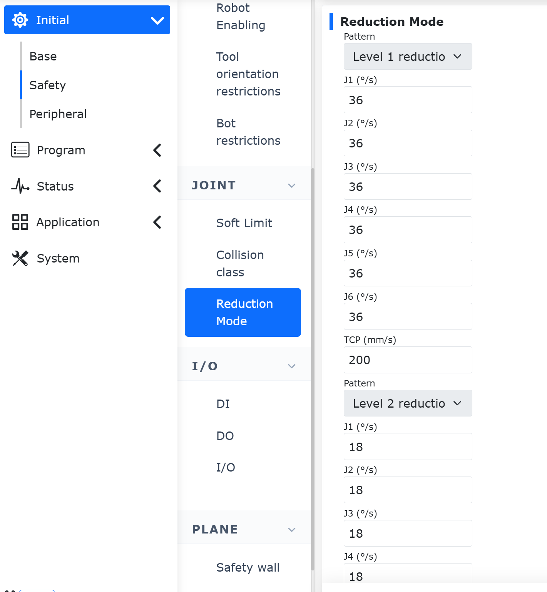

.. centered:: Abbildung 7.4-15 Reduzierter Modus

I/O
~~~~~~~~~~~~~~~~~~~~~~~~~~~~~~~~~~~~~~~~~~~~~~~~~~~
Klicken Sie in der Menüleiste auf "Grundeinstellungen" -> "Sicherheit" und klicken Sie auf das Untermenü "I/O", um zur Konfigurationsoberfläche zu gelangen.

HMI bietet die Möglichkeit, den Sicherheitszustand für 16 digitale Eingänge und 16 digitale Ausgänge festzulegen, die auf gültig oder ungültig gesetzt werden können. Wenn die Steuerung feststellt, dass sie sich in einem Sicherheitszustand befindet, werden die 16 digitalen Eingänge und die 16 digitalen Ausgänge auf den Sicherheitszustand gesetzt.

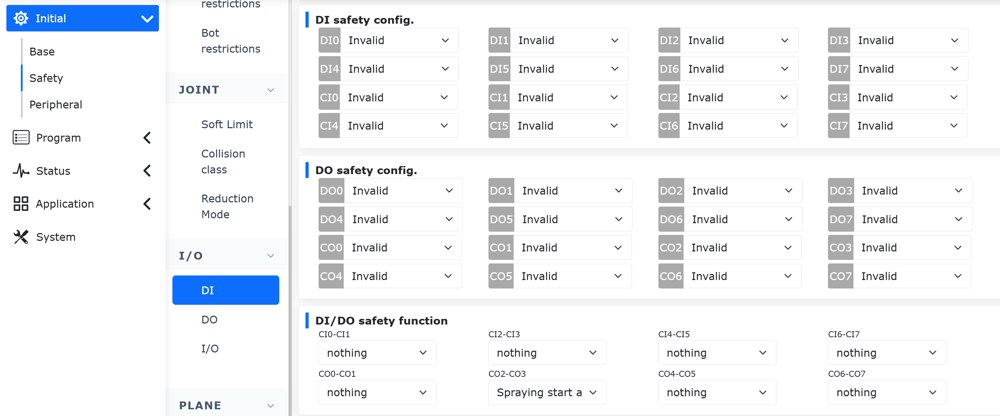

.. centered:: Abbildung 7.4-16 I/O-Sicherheitszustandskonfiguration

Unter dem LA-System:

"I/O-Sicherheit" bietet DIO-Sicherheitsfunktionen. Die Sicherheitsfunktion ist zweikanaliges DI oder DO. Wenn ein Sicherheits-DI-Signal oder ein Sicherheitszustandsflag ausgelöst wird, wird der DO ausgegeben.

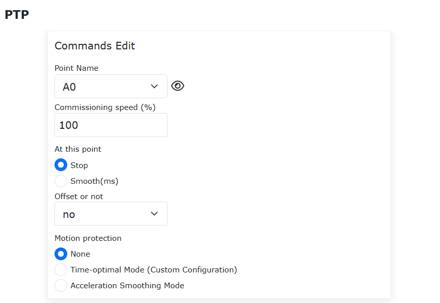

.. centered:: Abbildung 7.4-17 I/O-Sicherheitsfunktionskonfiguration

Hardware
~~~~~~~~~~~~~~~~~~~~~~~~~~~~~~~~~~~~~~~~~~~~~~~~~~~

ServoJT-Leistungserkennung (Nur im QX-System verwendet)
+++++++++++++++++++++++++++++++++++++++++++++++++++++++++++++++++++++++++++++++++++++++++++++++++++++++
Klicken Sie in der Menüleiste auf "Grundeinstellungen" -> "Sicherheit" und klicken Sie auf das Untermenü "Leistungserkennung", um zur Konfigurationsoberfläche zu gelangen.

Wenn direkt auf den Stromregelkreis des Roboters (nur servoJT) eingewirkt wird, wird er verwendet, um die vom Roboter geleistete Arbeit zu begrenzen. Wenn das Integral der Robotergeschwindigkeit und des Drehmoments den Grenzwert überschreitet, wird der Leistungsschutz aktiviert.

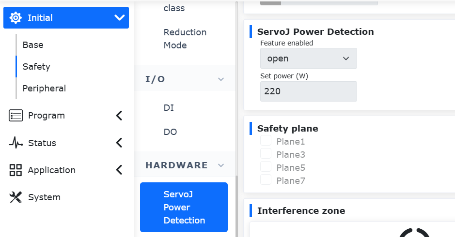

.. centered:: Abbildung 7.4-18 ServoJT-Leistungserkennung

Ebenen
~~~~~~~~~~~~~~~~~~~~~~~~~~~~~~~~~~~~~~~~~~~

Sicherheitswand
+++++++++++++++++++++++++++++++++++++++++++++++++++++++++++++++++++++++++++++++++++++++++++++++++++++++

Klicken Sie in der Menüleiste auf "Grundeinstellungen" -> "Sicherheit" und klicken Sie auf das Untermenü "Sicherheitswandkonfiguration", um zur Konfigurationsoberfläche zu gelangen.

- Sicherheitswandkonfiguration: Klicken Sie auf die Schaltfläche Aktivieren, um die entsprechende Sicherheitswand zu aktivieren. Wenn für eine Sicherheitswand kein Sicherheitsbereich konfiguriert wurde, wird ein Fehler angezeigt. Klicken Sie auf die Konfigurationsschaltfläche in der oberen rechten Ecke, wählen Sie die Sicherheitswand aus, die Sie einrichten möchten, der Sicherheitsabstand wird automatisch angezeigt (optional, Standard 0), und klicken Sie dann auf die Schaltfläche "Einstellen", um die Einstellung erfolgreich durchzuführen.
- Konfiguration der Sicherheitswand-Referenzpunkte: Nach der Auswahl einer Sicherheitswand können vier Referenzpunkte eingestellt werden. Die ersten drei Punkte sind Ebenenreferenzpunkte, die verwendet werden, um die Ebene der eingestellten Sicherheitswand zu bestätigen. Der vierte Punkt ist der Sicherheitsbereichs-Referenzpunkt, der verwendet wird, um den Sicherheitsbereich der eingestellten Sicherheitswand zu bestätigen.

Wenn die Referenzpunkte erfolgreich eingestellt wurden, wird ein grünes Licht angezeigt. Andernfalls wird ein gelbes Licht angezeigt, bis die Referenzpunkte erfolgreich eingestellt sind und grün werden. Wenn alle vier Referenzpunkte erfolgreich eingestellt wurden, kann der Sicherheitsbereich berechnet werden. Nach erfolgreicher Berechnung wird der Status des Sicherheitsbereichsparameterpunkts auf den Standardwert zurückgesetzt.

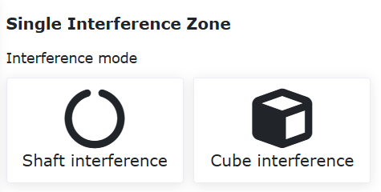

.. centered:: Abbildung 7.4-19 Einstellungen der Sicherheitsbereichs-Referenzpunkte

- Anwendungseffekt: Aktivieren Sie die erfolgreich konfigurierte Sicherheitswand. Ziehen Sie den Roboter. Wenn sich der TCP des Roboterendes innerhalb des eingestellten Sicherheitsbereichs befindet, ist das System normal. Wenn er sich außerhalb des eingestellten Sicherheitsbereichs befindet, wird ein Fehler angezeigt.

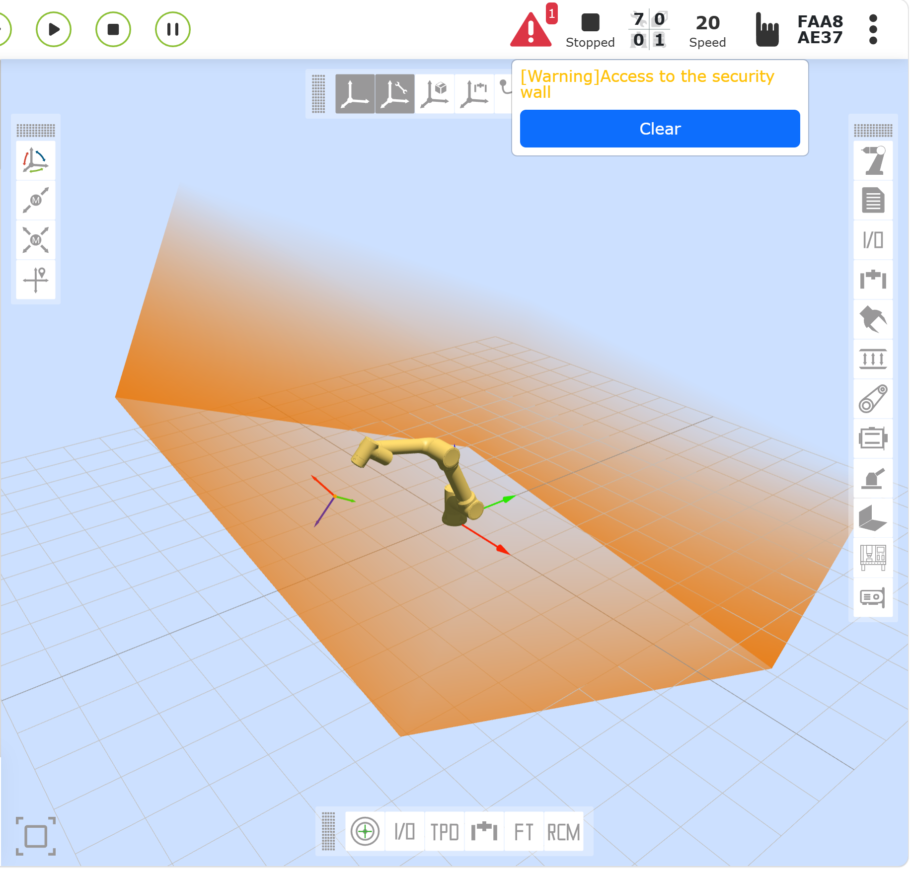

.. centered:: Abbildung 7.4-20 Effekt nach erfolgreicher Sicherheitsbereichseinstellung

Interferenzzone
+++++++++++++++++++++++++++++++++++++++++++++++++++++++++++++++++++++++++++++++++++++++++++++++++++++++

Klicken Sie in der Menüleiste auf "Grundeinstellungen" -> "Sicherheit" -> "Interferenzzone" und klicken Sie auf das Untermenü "Einzel", um zur Konfigurationsoberfläche der Interferenzzone zu gelangen.

Wir müssen die Interferenzmethode und den Vorgang beim Betreten der Interferenzzone konfigurieren. Die Interferenzmethoden sind in "Achseninterferenz" und "Quaderinterferenz" unterteilt.

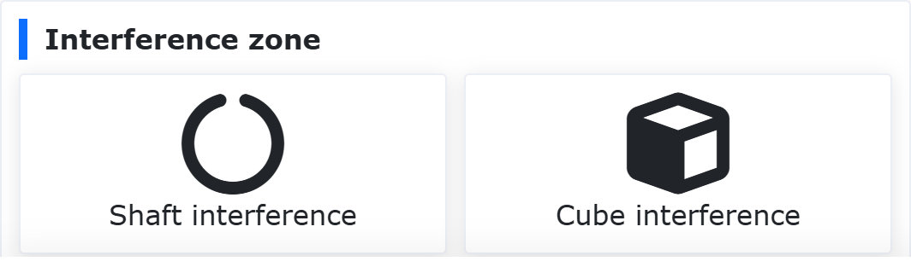

.. centered:: Abbildung 7.4-21 Interferenzzonenmethoden

Klicken Sie auf das Symbol der Interferenzzone, verwenden Sie den Schalter, um zu steuern, ob sie aktiviert ist, und klicken Sie auf die Konfigurationsschaltfläche in der oberen rechten Ecke für die Parameterkonfiguration.

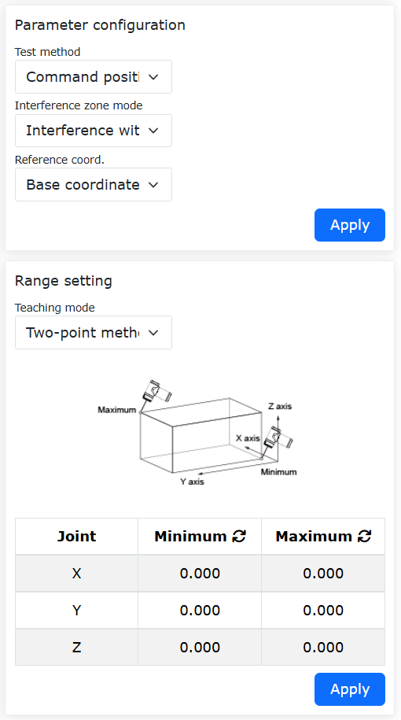

.. centered:: Abbildung 7.4-22 Interferenzzonenkonfiguration

Konfigurieren Sie zunächst die Interferenzzonenbewegung als "Bewegung fortsetzen" oder "Stopp". Stellen Sie als Nächstes die Ziekkonfiguration beim Betreten der Interferenzzone ein. Benutzer können die Strategie nach dem Betreten der Interferenzzone im Ziehmodus entsprechend ihren Bedürfnissen einstellen: keine Zieheinschränkung, Impedanzrückkehr oder Wechsel in den Handmodus.

Bei Auswahl von Achseninterferenz müssen die Achseninterferenzparameter konfiguriert werden. Die Erkennungsmethode kann "Befehlsposition" oder "Rückmeldeposition" sein. Der Interferenzzonenmodus kann "Interferenz innerhalb des Bereichs" oder "Interferenz außerhalb des Bereichs" sein. Als nächstes stellen Sie den Bereich für jedes Gelenk ein und ob der Bereich für jedes Gelenk aktiviert ist. Sie können Werte eingeben oder das "Aktualisierungs"-Symbol nach "Min" und "Max" verwenden, um die aktuelle Roboterposition zu erfassen, und klicken Sie schließlich auf Konfigurieren.

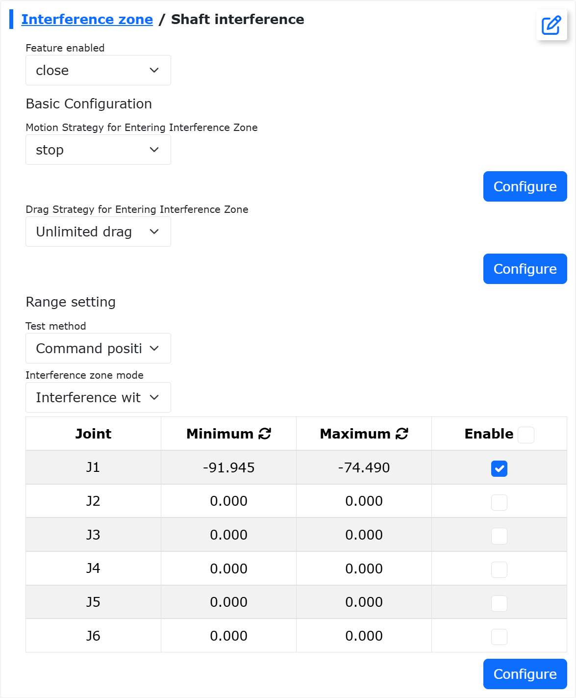

.. centered:: Abbildung 7.4-23 Achseninterferenzkonfiguration

Bei Auswahl von Quaderinterferenz müssen die Quaderinterferenzparameter konfiguriert werden. Die Erkennungsmethode kann "Befehlsposition" oder "Rückmeldeposition" sein. Der Interferenzzonenmodus kann "Interferenz innerhalb des Bereichs" oder "Interferenz außerhalb des Bereichs" sein. Das Referenzkoordinatensystem kann "Basenkoordinate" oder "Werkstückkoordinate" sein, ausgewählt je nach tatsächlicher Verwendung. Als nächstes stellen Sie den Bereich ein. Es gibt zwei Methoden für die Bereichseinstellung. Die erste Methode ist die "Zwei-Punkte-Methode", bei der zwei diagonale Eckpunkte des Quaders verwendet werden. Positionen können eingegeben oder durch Roboter-Teach-in aufgezeichnet werden. Klicken Sie schließlich auf Übernehmen.

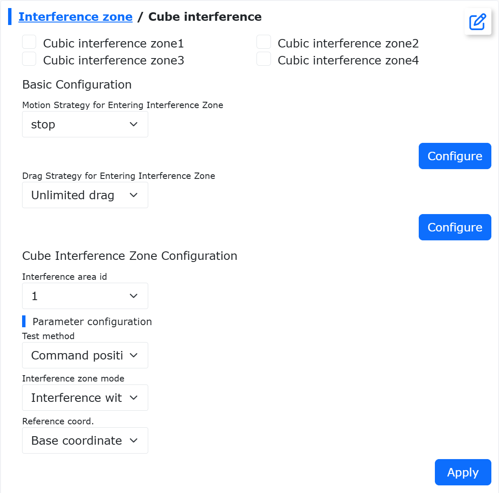

.. centered:: Abbildung 7.4-24 Quaderinterferenzkonfiguration

Die zweite Methode ist die "Mittelpunkt + Seitenlänge"-Methode, bei der der Mittelpunkt des Quaders und die Seitenlänge des Quaders die Interferenzzone bilden. Positionen können eingegeben oder durch Roboter-Teach-in aufgezeichnet werden. Klicken Sie schließlich auf Übernehmen.

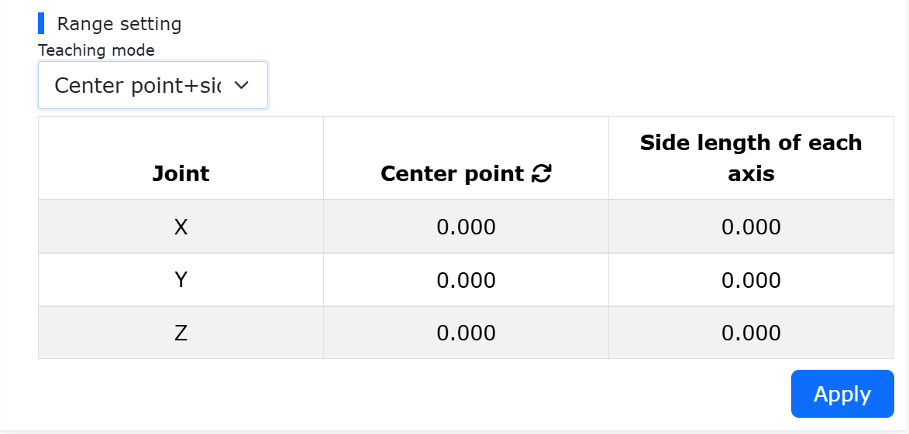

.. centered:: Abbildung 7.4-25 Quaderinterferenzkonfiguration
   
Sicherheitsprotokoll-Speicherfunktion
~~~~~~~~~~~~~~~~~~~~~~~~~~~~~~~~~~~~~~~~~~~~~~~~~~~~~~~~~~~~~~~~~~~~~~~~~~~~~~~~~~~~~~~~~~~~~~~

Hintergrund
+++++++++++++++++++++++++++++++++++++++++++++++++++++++++

Die CE-Zertifizierung für Roboter der FR-Serie erfordert, dass alle sicherheitsrelevanten Betriebsprotokolle des Geräts separat aufgezeichnet und gepflegt werden. Sie verlangt außerdem ausdrücklich, dass die Protokollspeicherung mindestens den letzten Eingriffsnachweis für jede Eingriffsart enthält, dass die Verfolgungsprotokolldaten für jeden Eingriff mindestens 5 Jahre aufbewahrt werden und dass die Protokolle vor Manipulation geschützt werden.

Sicherheitsprotokollverwaltung
+++++++++++++++++++++++++++++++++++++++++++++++++++++++++

Die Sicherheitsprotokollverwaltung wird auf der Webseite unter "Grundeinstellungen" -> "Sicherheit" gepflegt. Zuerst muss das "Sicherheitskonfigurationskennwort" zur Überprüfung eingegeben werden, und erst nach erfolgreicher Überprüfung kann die Sicherheitsprotokollverwaltung durchgeführt werden.

.. centered:: Abbildung 7.4-26 Sicherheitsprotokollverwaltung

Sicherheitsprotokolle werden einheitlich verwaltet. Um ein übermäßiges Protokollvolumen durch anormale Vorgänge zu verhindern, kann das aktuelle Protokollspeichervolumen intuitiv auf der Seite angezeigt werden. Sicherheitsprotokolle behalten nur die letzten 5 Jahre, und die Protokolle jedes Jahres werden je nach Protokolltyp einheitlich in separaten Dateien gespeichert. Klicken Sie auf Exportieren, um alle Protokolle zu exportieren.

Die Protokolltypen sind in die folgenden drei Kategorien unterteilt:

.. centered:: Tabelle 1-2 Klassifizierung der Sicherheitsprotokolle

.. list-table::
   :widths: 30 30 40
   :header-rows: 0
   :align: center

   * - **Protokollkategorie**
     - **Protokolldateiname**
     - **Beschreibung**

   * - Parameteränderung
     - safetylog_params_2026.log
     - Änderung der Sicherheitskonfigurationsparameter des Roboters, Änderung des Robotersicherheitskennworts

   * - Software-/Firmware-Version
     - safetylog_version_2026.log
     - Software-/Firmware-Versionsaktualisierung

   * - Protokollvorgang
     - safetylog_operate_2026.log
     - Löschung, Export des Sicherheitsprotokolls

Da Sicherheitsprotokolle 5 Jahre aufbewahrt werden müssen und nicht gelöscht werden können, wird zur Verhinderung von Speicheranomalien durch anormale Schreibvorgänge, die den Systembetrieb beeinträchtigen könnten, für Sicherheitsprotokolle eine gestufte Ratenbegrenzungsstrategie basierend auf der genutzten Kapazität verwendet. Vor dem Schreiben wird der aktuell genutzte Protokollspeicherplatz überprüft und die Schreibfrequenz dynamisch angepasst.

.. centered:: Tabelle 1-3 Ratenbegrenzungsstrategie für Sicherheitsprotokolle

.. list-table::
   :widths: 20 30 20 30
   :header-rows: 0
   :align: center

   * - **Phase**
     - **Genutzte Kapazität**
     - **Schreibfrequenz**
     - **Beschreibung**

   * - 1
     - <500M
     - Unbegrenzt
     - Normaler Gebrauch (ca. 200M für 5 Jahre)

   * - 2
     - 500M-1G
     - 1 Sekunde/Eintrag
     - Leichte Ratenbegrenzung, kein Einfluss auf die Erfahrung

   * - 3
     - 1G-2.5G
     - 5 Sekunden/Eintrag
     - Offensichtliche Anomalie, proaktive Geschwindigkeitsreduzierung

   * - 4
     - 2.5G-4G
     - 30 Sekunden/Eintrag
     - Schwere Anomalie, extreme Verzögerungszeit

   * - 5
     - >4G
     - Schreiben stoppen
     - Kontingent erschöpft, kein weiteres Protokollschreiben

Bei normalem Gebrauch, bei einem Schreibvolumen von 1000 Einträgen pro Tag, wird der geschätzte Verbrauch über 5 Jahre innerhalb von 200M liegen. Wenn der Speicher 1G überschreitet, liegt daher eindeutig eine anormale Situation vor. Nach Überschreiten von 1G meldet die Steuerung proaktiv eine Warnung. Es ist erforderlich, Protokolle proaktiv zu exportieren und zu sichern, und eine rechtzeitige Protokollbereinigung wird empfohlen.

.. centered:: Abbildung 7.4-27 Warnung bei Anomalie des Sicherheitsprotokolls

Die Exportzeit des Protokolls hängt von der Gesamtgröße des Protokolls ab. Theoretisch wird das Gesamtprotokollvolumen über 5 Jahre 200M nicht überschreiten. Wenn Protokolle 1G überschreiten, überschreitet die Downloadzeit 1 Minute, und bei der Obergrenze von 4G beträgt die Downloadzeit etwa 5 Minuten. Nach dem Export kann eine Protokollbereinigung durchgeführt werden. Um sicherzustellen, dass anormale Beweise nicht bereinigt werden, löscht die aktuelle Protokolllöschfunktion nur Protokolle aus Jahren, die nicht das aktuelle Jahr sind.

.. centered:: Abbildung 7.4-28 Löschung des Sicherheitsprotokolls

Funktionale Sicherheitsfunktionen
----------------------------------------------------------------

Beschreibung der funktionalen Sicherheit
~~~~~~~~~~~~~~~~~~~~~~~~~~~~~~~~~~~~~~~~~~~~~~~~~~~~~~~~~~~~~~~~~

Dieses Gerät ist mit einem sicherheitsbezogenen Steuerungssystem ausgestattet, das bei Erkennung einer gefährlichen Situation automatisch Sicherheitsmaßnahmen ausführt (z. B. Not-Halt, Schutz Türverriegelung usw.). Diese Sicherheitsfunktionen wurden gemäß den Normen EN ISO 13849-1 / EN IEC 62061 entworfen und verifiziert und sind ein wichtiger Bestandteil der CE-Konformität.

Um sicherzustellen, dass die Sicherheitsfunktionen wirksam bleiben, beachten Sie bitte:

- Umgehen oder überbrücken Sie keine Sicherheitseinrichtungen (z. B. Entfernen von Verriegelungsschaltern, Überbrücken von Sicherheitskreisen, Abdecken von Lichtvorhängen usw.), da dies zu schweren Personenschäden führen kann.
- Verändern Sie keine sicherheitsbezogenen Komponenten oder Softwareprogramme ohne Genehmigung. Jegliche Änderung, Parameteränderung oder Softwareaktualisierung am Sicherheitssteuerungssystem muss vom Hersteller oder seinem autorisierten Personal durchgeführt werden, und es muss erneut eine Risikobeurteilung durchgeführt werden.
- Netzwerksicherheit: Schließen Sie das Sicherheitssteuerungssystem dieses Geräts nicht an ein nicht autorisiertes Netzwerk an; nicht autorisierter digitaler Zugriff kann zum Ausfall der Sicherheitsfunktionen führen.
- Wartung und Fehler: Wenn eine Sicherheitseinrichtung abnormal funktioniert oder ausfällt, stoppen Sie die Maschine sofort und wenden Sie sich an den Hersteller oder autorisiertes Servicepersonal. Nur geschultes und autorisiertes Personal darf Wartungsarbeiten durchführen.

Dieses Gerät wird gemäß der EU-Maschinenverordnung (EU) 2023/1230 einer Konformitätsbewertung unterzogen. Die Komponenten der Sicherheitsfunktionen sind in der technischen Dokumentation aufgeführt. Nachfolgend finden Sie die spezifische Liste der Sicherheitsfunktionen.

.. centered:: Tabelle 1-1  Liste der Sicherheitsfunktionen

.. list-table::
   :widths: 20 20 10 40 10
   :header-rows: 0
   :align: center

   * - **SF-ID**
     - **Funktionsname**
     - **Stufe**
     - **Beschreibung**
     - **MTTFd***

   * - SF01
     - E-STOP on TPU-Not-Halt am Teach-Pendant
     - PL d
     - | Execution monitoring of the emergency stop-Überwachung der Ausführung des Not-Halts
       | Enthält Auslöselogik für verschiedene Auslösequellen:
       | 1. In jedem Modus wird beim Auslösen des Not-Halt-Schalters am Teach-Pendant dieser in ein Not-Halt-Signal des Steuerkastens umgewandelt, und je nach konfiguriertem Typ wird eine Cat.0- oder Cat.1-Stoppaktion mit verriegelter Positionshaltefunktion ausgeführt
       | 2. In jedem Modus wird beim Auslösen des Sicherheits-DI des Steuerkastens dieser in ein Not-Halt-Signal des Steuerkastens umgewandelt, und je nach konfiguriertem Typ wird eine Cat.0- oder Cat.1-Stoppaktion mit verriegelter Positionshaltefunktion ausgeführt
       | [Auslöseereignis]: Not-Halt-Signal ausgelöst
       | [Roboterreaktion]:
       | Wenn der Stopptyp 0 ist, wird die Körperstromversorgung unterbrochen, die Gelenke führen eine sichere Bremse aus, und die Positionshaltung wird überwacht
       | Wenn der Stopptyp 1 ist, wird ein Verzögerungsstopp durchgeführt, die Körperstromversorgung unterbrochen, die Gelenke führen eine sichere Bremse aus, und die Positionshaltung wird überwacht	
     - 202.0512143

   * - SF02
     - Safeguard Stop-Schutzstopp
     - PL d
     - | Execution monitoring of the safeguard stop-Überwachung der Ausführung des Schutzstopps
       | In jedem Modus wird die Sicherheitsstoppfunktion gemäß dem Sicherheitsstoppsignal des Steuerkastens ausgelöst. Je nach konfiguriertem Sicherheitsstoppniveau werden die entsprechenden Cat.0-, Cat.1-, Cat.2-Stoppfunktionen und die entsprechende verriegelte Positionshaltefunktionserkennung (Cat.0, Cat.1) oder Stillstandserkennung + Stoppweg + Stoppzeit-Erkennung (Cat.2) ausgeführt.
       | [Auslöseereignis]: Sicherheitsstoppsignal ausgelöst;
       | [Roboterreaktion]:
       | Wenn der Stopptyp 0 ist, wird die Körperstromversorgung unterbrochen, die Gelenke führen eine sichere Bremse aus, und die Positionshaltung wird überwacht;
       | Wenn der Stopptyp 1 ist, wird ein Verzögerungsstopp durchgeführt, die Körperstromversorgung unterbrochen, die Gelenke führen eine sichere Bremse aus, und die Positionshaltung wird überwacht;
       | Wenn der Stopptyp 2 ist, wird ein Verzögerungsstopp durchgeführt, die Körperstromversorgung bleibt erhalten, die Gelenke führen keine sichere Bremse aus und bleiben freigegeben, und es werden Stillstandserkennung + Stoppweg + Stoppzeit-Erkennung durchgeführt;	
     - 191.3170862

   * - SF03
     - Joint Position Limit-Gelenkpositionsbegrenzung
     - PL d
     - | Monitoring of the joint position limit-Überwachung der Gelenkpositionsbegrenzung
       | [Für jedes Gelenk können Gelenk-Soft-Limits festgelegt werden. Die Sicherheitsplatine erkennt die Gelenkposition in Echtzeit. Bei Überschreitung des Limits wird eine Cat.2-Stoppaktion mit verriegelter Stillstandserkennung + Stoppweg + Stoppzeit-Erkennung ausgeführt.
       | [Auslöseereignis]: Das Gelenk bewegt sich außerhalb des Begrenzungspositionsbereichs;
       | [Roboterreaktion]: Fehleralarm - Soft-Limit überschritten, Cat.2-Stoppaktion wird ausgeführt, mit verriegelter Stillstandserkennung + Stoppweg + Stoppzeit-Erkennung;
     - 158.5302637

   * - SF04
     - Joint Speed Limit-Gelenkgeschwindigkeitsbegrenzung
     - PL d
     - | Monitoring of the joint speed limit-Überwachung der Gelenkgeschwindigkeitsbegrenzung	
       | Für jedes Gelenk kann eine Gelenkgeschwindigkeitsbegrenzung festgelegt werden. Der Sicherheitskreis erkennt anhand der entsprechenden Sicherheitsgeschwindigkeit des Controllers, ob die Echtzeitgeschwindigkeit jedes Robotergelenks das Limit überschreitet. Bei Überschreitung wird ein Cat.1-Stopp mit verriegelter Positionshalteüberwachung oder ein Cat.2-Stopp mit verriegelter Stillstandserkennung + Stoppweg + Stoppzeit-Erkennung ausgeführt.
       | [Auslöseereignis]: Die Gelenkgeschwindigkeit überschreitet den eingestellten Wert;
       | [Roboterreaktion]: Fehleralarm - Geschwindigkeit überschritten. Optional Cat.1-Stopp mit verriegelter Positionshalteüberwachung oder standardmäßig Cat.2-Stopp mit verriegelter Stillstandserkennung + Stoppweg + Stoppzeit-Erkennung;	
     - 158.5302637
          
   * - SF05
     - Joint Torque Limit-Gelenkmomentbegrenzung
     - PL d
     - | Monitoring of the joint torque limit-Überwachung der Gelenkmomentbegrenzung
       | Für jedes Gelenk kann eine Gelenkmomentbegrenzung festgelegt werden. Der Sicherheitskreis erkennt anhand des entsprechenden Sicherheitsmoments des Controllers, ob das Echtzeitmoment jedes Robotergelenks das Limit überschreitet. Bei Überschreitung wird ein Cat.2-Stopp mit verriegelter Stillstandserkennung + Stoppweg + Stoppzeit-Erkennung ausgeführt
       | [Auslöseereignis]: Das Gelenkmoment überschreitet den eingestellten Momentwert
       | [Roboterreaktion]: Fehleralarm - Gelenk-x-Moment überschritten, Cat.2-Stopp wird ausgeführt, mit verriegelter Stillstandserkennung + Stoppweg + Stoppzeit-Erkennung
     - 67.48193213
     	          
   * - SF06
     - | TCP Pose Limit-TCP-Posenbegrenzung (Sicherheitsebene, Werkzeugrichtung)
       | (Dynamic Limit kann dynamisch angepasst werden; Stopptyp nicht erforderlich)
       | (Entsprechende Limits werden über konfigurierbare IO dynamisch angepasst, Doppelkreis)
     - PL d
     - | Monitoring of the TCP pose limit-Überwachung der TCP-Posenbegrenzung
       | Der TCP-Begrenzungsbereich und das entsprechende DI (bis zu 8 konfigurierbar) werden vorab auf der entsprechenden Controllerseite festgelegt. Wenn das DI aktiviert wird, wird das entsprechende Limit aktiviert. Wenn der TCP den Begrenzungsbereich überschreitet, wird ein Cat.2-Stopp mit verriegelter Stillstandserkennung + Stoppweg + Stoppzeit-Erkennung ausgeführt
       | [Auslöseereignis]: Die TCP-Pose überschreitet den eingestellten Bereich
       | [Roboterreaktion]: Fehleralarm - Sicherheitsebene/Werkzeugrichtung überschritten, Cat.2-Stoppaktion wird ausgeführt, mit verriegelter Stillstandserkennung + Stoppweg + Stoppzeit-Erkennung	
     - 70.07272665
          	          
   * - SF07
     - manual mode, reduced-speed-Manueller Modus, reduzierte Geschwindigkeit
     - PL d
     - | Monitoring of reduced-speed manual mode-Überwachung des manuellen Modus mit reduzierter Geschwindigkeit
       | Wenn sich der Controllermodus im manuellen Modus mit reduzierter Geschwindigkeit befindet, wird erkannt, ob die TCP-Geschwindigkeit ≤250mm/s ist. Bei Überschreitung wird eine Cat.0- oder Cat.1-Stoppaktion mit verriegelter Positionshalteüberwachung ausgeführt.
       | [Auslöseereignis]: Die TCP-Geschwindigkeit überschreitet die eingestellte Geschwindigkeit
       | [Roboterreaktion]: Fehleralarm - TCP-Übergeschwindigkeit, Cat.0- oder Cat.1-Stoppaktion wird ausgeführt, mit verriegelter Positionshalteüberwachung.	
     - 70.07272665
             	          
   * - SF08
     - TCP Force Limit-TCP-Kraftbegrenzung
     - PL d
     - | Monitoring of the TCP force limit-Überwachung der TCP-Kraftbegrenzung  
       | Der Controller kann die TCP-Kraftbegrenzung konfigurieren. Der Sicherheitskreis überwacht die TCP-Kraft des Roboters in Echtzeit. Wenn die TCP-Kraft den Grenzwert überschreitet, wird ein Cat.2-Stopp mit verriegelter Stillstandserkennung + Stoppweg + Stoppzeit-Erkennung ausgeführt
       | [Auslöseereignis]: Die TCP-Kraft überschreitet den eingestellten Grenzwert
       | [Roboterreaktion]: Fehleralarm - Kollisionsfehler Gelenk x, Cat.2-Stopp wird ausgeführt, mit verriegelter Stillstandserkennung + Stoppweg + Stoppzeit-Erkennung	
     - 124.720124  
             	          
   * - SF09
     - Momentum Limit-Impulsbegrenzung
     - PL d
     - | Monitoring of the momentum limit-Überwachung der Impulsbegrenzung
       | Der Controller kann die Impulsbegrenzung des Roboters konfigurieren. Der Sicherheitskreis überwacht den Impuls des Roboters in Echtzeit. Wenn der Impuls des Roboters den Grenzwert überschreitet, wird ein Cat.2-Stopp mit verriegelter Stillstandserkennung + Stoppweg + Stoppzeit-Erkennung ausgeführt
       | [Auslöseereignis]: Der Impuls überschreitet den eingestellten Impulsgrenzwert
       | [Roboterreaktion]: Fehleralarm - Impuls überschritten, Cat.2-Stopp wird ausgeführt, mit verriegelter Stillstandserkennung + Stoppweg + Stoppzeit-Erkennung	
     - 67.48193213
                	          
   * - SF10
     - Power Limit-Leistungsbegrenzung
     - PL d
     - | Monitoring of the power limit-Überwachung der Leistungsbegrenzung    
       | Der Controller kann die Leistungsbegrenzung des Roboters konfigurieren. Der Sicherheitskreis überwacht die Leistung des Roboters in Echtzeit. Wenn die Leistung des Roboters den Grenzwert überschreitet, wird ein Cat.2-Stopp mit verriegelter Stillstandserkennung + Stoppweg + Stoppzeit-Erkennung ausgeführt
       | [Auslöseereignis]: Die Leistung überschreitet den eingestellten Leistungsgrenzwert
       | [Roboterreaktion]: Fehleralarm - Leistung überschritten, Cat.2-Stopp wird ausgeführt, mit verriegelter Stillstandserkennung + Stoppweg + Stoppzeit-Erkennung
     - 67.48193213
                	          
   * - SF11
     - System Emergency Stop Output-System-Not-Halt-Ausgang
     - PL d
     - | Monitoring of the System Emergency Stop Output-Überwachung des System-Not-Halt-Ausgangs
       | Wenn das Not-Halt-Signal ausgelöst wird, gibt der Controller ein Not-Halt-Signal DO aus.
       | [Auslöseereignis]: Not-Halt-Signal ausgelöst
       | [Roboterreaktion]:
       | Not-Halt-Typ 0: System-Not-Halt-Signalausgabe
       | Not-Halt-Typ 1: System-Not-Halt-Signalausgabe	
     - 191.3170862
                   	          
   * - SF12
     - Robot Moving State Output-Ausgang Roboterdzustand "In Bewegung"
     - PL d
     - | Monitoring of the Robot Moving State Output-Überwachung des Ausgangs "Roboter in Bewegung"
       | Wenn sich der Roboter im Bewegungszustand befindet, gibt der Controller ein Bewegungssignal DO aus
       | [Auslöseereignis]: Der Roboter befindet sich im Bewegungszustand
       | [Roboterreaktion]: Signalausgabe "Roboter in Bewegung"	
     - 68.7283255
                	          
   * - SF13
     - Robot Not Stopping State Output-Ausgang Roboterzustand "Nicht gestoppt"
     - PL d
     - | Monitoring of the Robot Not Stopping State Output-Überwachung des Ausgangs "Roboter nicht gestoppt"
       | Wenn sich der Roboter im Zustand "Nicht gestoppt" befindet, gibt der Controller ein Signal DO "Nicht gestoppt" aus
       | [Auslöseereignis]: Der Roboter befindet sich im Zustand "Nicht gestoppt"
       | [Roboterreaktion]: Signalausgabe "Roboter nicht gestoppt"	
     - 68.7283255

   * - SF14
     - Reduced Mode State Output-Ausgang Zustand "Reduzierter Modus"
     - PL d
     - | Monitoring of the Reduced Mode State Output-Überwachung des Ausgangs "Reduzierter Modus"
       | Wenn sich der Roboter im reduzierten Zustand befindet, gibt der Controller ein reduziertes Signal DO aus
       | [Auslöseereignis]: Der Roboter befindet sich im reduzierten Modus
       | [Roboterreaktion]: Signalausgabe "Reduzierter Modus"	
     - 68.7283255
    
   * - SF15
     - Not Reduced Mode State Output-Ausgang Zustand "Nicht reduzierter Modus"
     - PL d
     - | Monitoring of the Not Reduced Mode State Output-Überwachung des Ausgangs "Nicht reduzierter Modus"
       | Wenn sich der Roboter im nicht reduzierten Zustand befindet, gibt der Controller ein Signal DO "Nicht reduziert" aus
       | [Auslöseereignis]: Der Roboter befindet sich im nicht reduzierten Modus
       | [Roboterreaktion]: Signalausgabe "Nicht reduzierter Modus"	
     - 68.7283255
    
   * - SF16
     - 3P enabling function-Dreistellungs-Freigabefunktion
     - PL d
     - | 3P enabling function-Dreistellungs-Freigabefunktion
       | Wenn die Dreistellungs-Freigabe in Stellung 1 oder 3 ist, führt der Roboter einen Cat.2-Stopp mit verriegelter Stillstandserkennung + Stoppweg + Stoppzeit-Erkennung aus
       | Wenn die Dreistellungs-Freigabe in Stellung 2 ist, ist der Roboter freigegeben, mit verriegelter Aktivierung des manuellen Modus mit reduzierter Geschwindigkeit und der Erkennung reduzierter manueller Geschwindigkeit
       | [Auslöseereignis]: Im Modus des physischen Teach-Pendants wird die Dreistellungs-Freigabetaste in die mittlere Stellung (Stellung 2) gedrückt
       | [Roboterreaktion]: Gelenke werden freigegeben, sichere Gelenkbremsen werden gelöst, der Roboter geht in den manuellen Modus mit reduzierter Geschwindigkeit über, mit verriegelter Aktivierung des manuellen Modus mit reduzierter Geschwindigkeit und der Erkennung reduzierter manueller Geschwindigkeit	
     - 68.7283255
         
   * - SF17
     - monitored-standstill-Überwachter Stillstand (nach Cat.2-Stopp)
     - PL d
     - | Monitored standstill-Überwachter Stillstand
       | Nach Abschluss des Cat.2-Stopps erkennt der Sicherheitskreis Gelenkpositionsänderungen anhand des Roboterbefehls und der tatsächlichen Position. Bei Überschreitung der Abweichung wird ein Cat.0- oder Cat.1-Stopp ausgeführt
       | [Auslöseereignis]: Im Stillstand und ohne Bewegung ändert sich die Roboterposition ungewöhnlich
       | [Roboterreaktion]: Der Bereich der Roboterpositionsänderung überschreitet den eingestellten Wert, eine Cat.0- oder Cat.1-Stoppaktion wird ausgeführt	
     - 60.05290188
            
   * - SF18
     - stopping time limiting-Stoppzeitbegrenzung (nach Cat.2-Stopp)
     - PL d
     - | Monitoring of stopping time limit-Überwachung der Stoppzeitbegrenzung
       | Nach Auslösung des Cat.2-Stoppsignals erkennt der Sicherheitskreis die Stoppzeit anhand der Zeit des Stoppabschlusssignals des Roboters. Bei Überschreitung der Abweichung wird ein Cat.0- oder Cat.1-Stopp ausgeführt
       | [Auslöseereignis]: Wenn der Roboter einen Stopp auslöst
       | [Roboterreaktion]: Wenn der Roboter einen Stopp auslöst und die Stoppzeit die eingestellte Zeit überschreitet, wird eine Cat.0- oder Cat.1-Stoppaktion ausgeführt	
     - 60.05290188 
            
   * - SF19
     - stopping distance limiting-Stoppwegbegrenzung (nach Cat.2-Stopp)
     - PL d
     - | Monitoring of stopping distance limit-Überwachung der Stoppwegbegrenzung
       | Beim Auslösen des Cat.2-Stoppsignals wird die Roboterposition aufgezeichnet. Der Sicherheitskreis ermittelt den Stoppweg durch Subtraktion der aufgezeichneten Position von der Echtzeit-Istposition des Roboters. Bei Überschreitung der Abweichung wird ein Cat.0- oder Cat.1-Stopp ausgeführt
       | [Auslöseereignis]: Wenn der Roboter einen Stopp auslöst
       | [Roboterreaktion]: Wenn der Roboter einen Stopp auslöst und der Stoppweg den eingestellten Stoppweg überschreitet, wird eine Cat.0- oder Cat.1-Stoppaktion ausgeführt	
     - 60.05290188
                  
   * - SF20
     - hold-to-run control-Hold-to-Run-Steuerung
     - PL d
     - | Hold-to-run control-Hold-to-Run-Steuerung
       | Wenn der Dreistellungs-Freigabeschalter in die mittlere Stellung gelangt und der Controller sich im manuellen Modus befindet, geht der Roboter nach Drücken der Endtaste in den Ziehzustand über
       | Wenn der Dreistellungs-Freigabeschalter in die mittlere Stellung gelangt und der Controller sich im manuellen Modus befindet, geht der Roboter nach Loslassen der Endtaste in einen Cat.2-Stopp mit verriegelter Stillstandserkennung + Stoppweg + Stoppzeit-Erkennung über
       | [Auslöseereignis]: Der Dreistellungs-Freigabeschalter gelangt in die mittlere Stellung, der Controller ist im manuellen Modus, und die Endtaste wird gedrückt
       | [Roboterreaktion]: Der Roboter geht in den Ziehzustand über
       | [Auslöseereignis]: Der Dreistellungs-Freigabeschalter gelangt in die mittlere Stellung, der Controller ist im manuellen Modus, und die Endtaste wird losgelassen
       | [Roboterreaktion]: Der Roboter geht in einen Cat.2-Stopp mit verriegelter Stillstandserkennung + Stoppweg + Stoppzeit-Erkennung über
     - 68.7283255
                      
   * - SF21
     - start/restart interlock-Start-/Neustartverriegelung
     - PL d
     - | Start/restart interlock-Start-/Neustartverriegelung
       | Bei Start/Neustart/Moduswechsel wird der Cat.2-Sicherheitsstoppzustand ausgelöst. Nach Ausführung des Stopps kann sich der Controller nicht bewegen, mit verriegelter Stillstandserkennung. Der Stoppzustand muss durch Zurücksetzen des Sicherheitsstopps über DI zurückgesetzt werden, bevor weitere Operationen ausgeführt werden können
       | [Auslöseereignis]: Controller-Start/Neustart/Moduswechsel
       | [Roboterreaktion]: Verriegelung ausgelöst, Eintritt in Cat.2-Sicherheitsstopp	
     - 191.3170862
                      
   * - SF22
     - reset safety-Zurücksetzen des Sicherheitsstoppzustands
     - PL d
     - | Reset safety-Zurücksetzen des Sicherheitsstoppzustands
       | Im ausgelösten Sicherheitsstoppzustand zuerst Fehler-/Störungsrücksetzung über DI durchführen. Nach erfolgreicher Fehler-/Störungsrücksetzung erneut Stoppzustandsrücksetzung über DI durchführen, danach kann der Roboter den Stoppzustand verlassen
       | [Auslöseereignis]: DI zum Zurücksetzen des Sicherheitsstoppzustands ausgelöst
       | [Roboterreaktion]: Der Roboter verlässt den Sicherheitsstopp	
     - 191.3170862
                         
   * - SF23
     - normal stop-Normaler Stopp
     - PL d
     - | Normal stop-Normaler Stopp
       | Während der Roboterbewegung wird über ein DI-Signal ein normaler Stopp ausgelöst. Je nach konfiguriertem Sicherheitsstopptyp wird eine Cat.0- oder Cat.1-Stoppaktion ausgeführt
       | [Auslöseereignis]: Bewegungsstopp ausgelöst
       | [Roboterreaktion]: Der Roboter führt eine Cat.0- oder Cat.1-Stoppaktion mit verriegelter Positionshalteüberwachung aus	
     - 191.3170862
                         
   * - SF24
     - mode activation-Modusaktivierung
     - PL a
     - | Mode activation-Modusaktivierung
       | Der Controllermodus kann über den Modusschalter der Softwareoberfläche und den Endtastenschalter in verschiedene Modi wechseln, darunter manuell reduzierte Geschwindigkeit/manuell hohe Geschwindigkeit/automatisch/Ziehen
       | [Auslöseereignis]: Umschalten des Schalters der Softwareoberfläche
       | [Roboterreaktion]: Der Roboter kann zwischen manuell reduzierte Geschwindigkeit/manuell hohe Geschwindigkeit/automatisch umschalten, mit verriegelter Überwachung manuell reduzierte Geschwindigkeit/Überwachung manuell hohe Geschwindigkeit + Zeitüberwachung manuell hohe Geschwindigkeit/Überwachung manuell reduzierte Geschwindigkeit/Gelenkgeschwindigkeitsüberwachung
       | [Auslöseereignis]: Umschalten des Endziehschalters
       | [Roboterreaktion]: Der Roboter kann zwischen manuell reduzierte Geschwindigkeit/Ziehen umschalten, mit verriegelter Überwachung manuell reduzierte Geschwindigkeit/Überwachung der Ziehgeschwindigkeit/Stillstandsüberwachung	
     - /
                             
   * - SF25
     - Position Holding Monitoring-Überwachung der Positionshaltung
     - PL d
     - | Monitoring of the Position Holding-Überwachung der Positionshaltung
       | Wenn der Controller vom freigegebenen Zustand in den nicht freigegebenen Zustand übergeht, wird beim Bremseneingriff die Position aufgezeichnet, und es wird kontinuierlich erkannt, ob die Differenz zwischen der Robotergelenkposition und der aufgezeichneten Position den Grenzschwellenwert überschreitet. Bei Überschreitung des Schwellenwerts wird eine Cat.0-Operation ausgeführt
       | [Auslöseereignis]: Während des Bremseneingriffs überschreitet die Änderung der Robotergelenkposition den Schwellenwert
       | [Roboterreaktion]: Cat.0-Operation wird ausgeführt	
     - 60.05290188
                                
   * - SF26
     - single-point-of-control-Einzelner Steuerpunkt (lokaler/ferner Steuermodus)
     - PL a
     - | single-point-of-control-Einzelner Steuerpunkt
       | Der lokale Modus und der Fernsteuermodus des Controllers schließen sich gegenseitig aus. Der Modus wird manuell auf der Controlleroberfläche umgeschaltet, und es kann nur einer für die Steuerung ausgewählt werden
       | [Auslöseereignis]: Manuelles Umschalten des Steuermodus auf der Controlleroberfläche
       | [Roboterreaktion]: Der Controller kann jeweils nur einen Modus auswählen und blendet den Betrieb der anderen Steuerquelle aus	
     - /
                                   
   * - SF27
     - external control enable-Freigabe externe Steuerquelle
     - PL a
     - | external control enable-Freigabe externe Steuerquelle
       | Der Controller verfügt über einen Fernsteuermodus. Das Betreten und Verlassen des Fernmodus erfolgt manuell und lokal auf der Controlleroberfläche. In diesem Modus werden andere lokale Steuerfunktionen ausgeblendet
       | [Auslöseereignis]: Umschalten des Fernsteuermodus auf der lokalen Oberfläche
       | [Roboterreaktion]: Der Controller geht in den Fernmodus über und blendet den Betrieb der lokalen Steuerquelle aus	
     - /
                                   
   * - SF28
     - manual mode, high-speed-Manueller Modus, hohe Geschwindigkeit
     - PL d
     - | Monitoring of high-speed manual mode-Überwachung des manuellen Modus mit hoher Geschwindigkeit
       | Klicken Sie auf die Umschalttaste für manuell hohe Geschwindigkeit auf der Seite für manuell reduzierte Geschwindigkeit. Der Controller kann vom manuellen Modus mit reduzierter Geschwindigkeit in den manuellen Modus mit hoher Geschwindigkeit wechseln. Der Sicherheitskreis erkennt, ob die TCP-Geschwindigkeit ≤1000mm/s ist. Bei Überschreitung wird eine Cat.0- oder Cat.1-Stoppaktion mit verriegelter Positionshalteüberwachung ausgeführt
       | [Auslöseereignis]: Im Hochgeschwindigkeitsmodus überschreitet die TCP-Geschwindigkeit das eingestellte Limit
       | [Roboterreaktion]: Verzögerungsstopp wird durchgeführt, Fehleralarm - TCP-Übergeschwindigkeit, Cat.0- oder Cat.1-Stoppaktion wird ausgeführt, mit verriegelter Positionshalteüberwachung	
     - 60.05290188

   * - SF29
     - manual mode, high-speed time limitation-Manueller Modus, Zeitbegrenzung hohe Geschwindigkeit
     - PL d
     - | Monitoring of high-speed manual mode time limitation-Überwachung der Zeitbegrenzung des manuellen Hochgeschwindigkeitsmodus
       | Wenn sich der Controllermodus im manuellen Hochgeschwindigkeitsmodus befindet und der Dreistellungsschalter die mittlere Position verlässt, erkennt der Sicherheitskreis die Dauer. Bei Überschreitung von 5 min senkt der Steuerkasten die globale manuelle Hochgeschwindigkeitsgeschwindigkeit auf 25% (TCP-Geschwindigkeit 250mm/s), mit verriegelter entsprechender Geschwindigkeitsüberwachung (TCP-Geschwindigkeit ≤250mm/s)
       | [Auslöseereignis]: Im manuellen Hochgeschwindigkeitsmodus wird der 3P-Schalter länger als 5 min losgelassen
       | [Roboterreaktion]: Der Steuerkasten senkt die manuelle Hochgeschwindigkeitsgeschwindigkeit auf 250mm/s, mit verriegelter 250mm/s-Überwachung	
     - 49.81517752
   
   * - SF30
     - hand-guided control-Handgeführte Steuerung
     - PL d
     - | Monitoring of hand-guided control-Überwachung der handgeführten Steuerung
       | Wenn der Dreistellungsschalter in der mittleren Position ist und die Endziehtaste gedrückt wird, geht der Controllermodus in den Ziehmodus über. Der Sicherheitskreis erkennt, ob die TCP-Geschwindigkeit ≤250mm/s ist (konfigurierbare Geschwindigkeitsbegrenzung), jede Gelenkgeschwindigkeit ≤45°/s ist (über SF04 überwacht, konfigurierbare Geschwindigkeitsbegrenzung, konfigurierbar Cat.0/Cat.1), jede Gelenkpositionsbegrenzung (über SF03 überwacht, konfigurierbarer Bereich, Cat.2), TCP-Posenbegrenzung (über SF06 überwacht, konfigurierbarer Bereich, Cat.2). Bei Überschreitung wird eine Cat.0- oder Cat.1-Stoppaktion mit verriegelter Positionshalteüberwachung ausgeführt
       | [Auslöseereignis]: Die TCP-Geschwindigkeit überschreitet die Ziehbegrenzungsgeschwindigkeit (Standard 250mm/s, einstellbar)
       | [Roboterreaktion]: Verzögerungsstopp wird durchgeführt, Fehleralarm - TCP-Übergeschwindigkeit, Cat.0- oder Cat.1-Stoppaktion wird ausgeführt, mit verriegelter Positionshalteüberwachung
     - 49.81517752 	
   
   * - SF31
     - Speed and separation monitoring (SSM)-Geschwindigkeits- und Separierungsüberwachung
     - PL d
     - | Speed and separation monitoring-Geschwindigkeits- und Separierungsüberwachung
       | Wenn sich der Controllermodus im automatischen Modus befindet, erkennt der über das DI des Steuerkastens extern angeschlossene Fotoelektrik-Schalter/Abstandssensor-Schalter die relative Position von Maschine und Personal. Wenn das entsprechende Abstands-DI ein Signal empfängt, führt der Steuerkasten eine Sicherheitsreaktion aus. Je nach entsprechendem Abstand geht er in Reduzierung Stufe 1 (konfigurierbare Geschwindigkeit, Standard 200mm/s), Reduzierung Stufe 2 (konfigurierbare Geschwindigkeit, Standard 100mm/s) oder Reduzierung Stufe 3 (Bewegungsstopp) über. Gleichzeitig geht der Sicherheitskreis in die Geschwindigkeits- und Separierungsüberwachung über. Wenn die Geschwindigkeit nach Eintritt in die Reduzierung die der entsprechenden Reduzierungsstufe entsprechende Geschwindigkeit überschreitet, wird eine Cat.0- oder Cat.1-Stoppaktion mit verriegelter Positionshalteüberwachung ausgeführt
       | [Auslöseereignis]: Die TCP-Geschwindigkeit überschreitet die eingestellte Geschwindigkeit
       | [Roboterreaktion]: Verzögerungsstopp wird durchgeführt, Fehleralarm - TCP-Übergeschwindigkeit, Cat.0- oder Cat.1-Stoppaktion wird ausgeführt, mit verriegelter Positionshalteüberwachung	
     - 60.05290188

.. note:: Hinweis: ***MTTFd**: Mittlere Zeit bis zum gefahrbringenden Ausfall (Einheit: Jahre).

Gelenkgeschwindigkeitsbegrenzung
~~~~~~~~~~~~~~~~~~~~~~~~~~~~~~~~~~~~~~~~~~~~~~~~~~~~~~~~~~~~~~~~~
Nach Aktivierung der funktionalen Sicherheit überwacht diese Funktion die Gelenkrückmeldungsgeschwindigkeit des Roboters. Wenn die Bewegungsgeschwindigkeit den eingestellten Wert überschreitet, wird ein Sicherheitsstopp ausgeführt.

Der eingestellte Gelenkbegrenzungsgeschwindigkeitsbereich ist 1-180°/s, der Standardwert ist 45°/s.

.. centered:: Abbildung 7.5-1 Überwachung der Gelenkgeschwindigkeitsbegrenzung

.. note:: Hinweis: Wenn "Nicht aktivieren" gewählt wird, ist die Funktion nicht wirksam; nach der Aktivierung wird die Funktion wirksam und die Überwachung beginnt.

Manueller Modus - reduzierte Geschwindigkeit
~~~~~~~~~~~~~~~~~~~~~~~~~~~~~~~~~~~~~~~~~~~~~~~~~~~~~~~~~~~~~~~~~

Nach Aktivierung der funktionalen Sicherheit überwacht diese Funktion die TCP-Rückmeldungsgeschwindigkeit des Roboters im manuellen Modus mit reduzierter Geschwindigkeit. Wenn die Bewegungsgeschwindigkeit den eingestellten Wert überschreitet, wird ein Sicherheitsstopp ausgeführt.

Der eingestellte TCP-Begrenzungsgeschwindigkeitsbereich ist 1-1000mm/s, der Standardwert ist 250mm/s.

.. centered:: Abbildung 7.5-2 Überwachung manueller Modus - reduzierte Geschwindigkeit

Manueller Modus - hohe Geschwindigkeit
~~~~~~~~~~~~~~~~~~~~~~~~~~~~~~~~~~~~~~~~~~~~~~~~~~~~~~~~~~~~~~~~~

Nach Aktivierung der funktionalen Sicherheit überwacht diese Funktion die TCP-Rückmeldungsgeschwindigkeit des Roboters im manuellen Hochgeschwindigkeitsmodus (unter Verwendung der TCP-Geschwindigkeit entsprechend der globalen Oberflächengeschwindigkeit als Limit). Wenn die Bewegungsgeschwindigkeit den eingestellten Wert überschreitet, wird ein Sicherheitsstopp ausgeführt. Nach Einstellung einer Geschwindigkeit über 250mm/s wird die Deaktivierungszeit im manuellen Hochgeschwindigkeitsmodus überwacht. Wenn die Deaktivierungszeit den eingestellten Wert überschreitet, wird die manuelle Geschwindigkeit auf 250mm/s reduziert.

Der eingestellte Geschwindigkeits-Timeout-Bereich ist 1-1000min, der Standardwert ist 5min.

.. centered:: Abbildung 7.5-3 Überwachung manueller Modus - hohe Geschwindigkeit

Überwachung der Ziehgeschwindigkeit
~~~~~~~~~~~~~~~~~~~~~~~~~~~~~~~~~~~~~~~~~~~~~~~~~~~~~~~~~~~~~~~~~

Nach Aktivierung der funktionalen Sicherheit überwacht diese Funktion die TCP-Rückmeldungsgeschwindigkeit des Roboters im Ziehmodus. Wenn die Ziehgeschwindigkeit den eingestellten Wert überschreitet, wird ein Sicherheitsstopp ausgeführt.

Der eingestellte TCP-Begrenzungsgeschwindigkeitsbereich ist 1-1000mm/s, der Standardwert ist 250mm/s.

.. centered:: Abbildung 7.5-4 Überwachung der Ziehgeschwindigkeit

Überwachung der Positionshaltung
~~~~~~~~~~~~~~~~~~~~~~~~~~~~~~~~~~~~~~~~~~~~~~~~~~~~~~~~~~~~~~~~~

Nach Aktivierung der funktionalen Sicherheit dient diese Funktion zur Überwachung der Position des Roboters nach der Deaktivierung. Wenn die Änderungsmenge jedes Gelenks den eingestellten Wert überschreitet, wird ein Sicherheitsstopp ausgeführt.

Der eingestellte TCP-Begrenzungsgeschwindigkeitsbereich ist 1-1000mm/s.

.. centered:: Abbildung 7.5-5 Überwachung der Positionshaltung

Manueller Hochgeschwindigkeitsmodus
~~~~~~~~~~~~~~~~~~~~~~~~~~~~~~~~~~~~~~~~~~~~~~~~~~~~~~~~~~~~~~~~~

Nach Aktivierung der funktionalen Sicherheit klicken Sie auf der Oberfläche für manuell reduzierte Geschwindigkeit auf die Schaltfläche "Manuell hohe Geschwindigkeit betreten", um in den manuellen Hochgeschwindigkeitsmodus zu gelangen. In diesem Modus wird die Geschwindigkeit von JOG-Bewegung und befehlter Bewegung nicht reduziert.

.. centered:: Abbildung 7.5-6 Manueller Hochgeschwindigkeitsmodus

Normaler Stopp
~~~~~~~~~~~~~~~~~~~~~~~~~~~~~~~~~~~~~~~~~~~~~~~~~~~~~~~~~~~~~~~~~

Nach Aktivierung der funktionalen Sicherheit kann auf der Sicherheits-CI-Seite die digitale Eingabeoption "Normaler Stopp" ausgewählt werden. Wenn das entsprechende CI ausgelöst wird, stoppt der Roboter gemäß dem konfigurierten Schutzstoppniveau.

.. centered:: Abbildung 7.5-7 Normaler Stopp

Sicherheitswand
~~~~~~~~~~~~~~~~~~~~~~~~~~~~~~~~~~~~~~~~~~~~~~~~~~~~~~~~~~~~~~~~~

Nach Aktivierung der funktionalen Sicherheit können auf der Sicherheits-CI-Seite die digitalen Eingabeoptionen "Sicherheitswand 1" bis "Sicherheitswand 8" ausgewählt werden. Wenn das entsprechende CI ausgelöst wird, aktiviert der Roboter die entsprechende Sicherheitswandüberwachung. Wenn er in den Begrenzungsbereich der Sicherheitswand gelangt, stoppt der Roboter gemäß dem konfigurierten Schutzstoppniveau.

.. centered:: Abbildung 7.5-8 Sicherheitswand

Sicherheitsstoppzustand zurücksetzen
~~~~~~~~~~~~~~~~~~~~~~~~~~~~~~~~~~~~~~~~~~~~~~~~~~~~~~~~~~~~~~~~~

Nach Aktivierung der funktionalen Sicherheit kann auf der Sicherheits-CI-Seite die digitale Eingabeoption "Sicherheitsstoppzustand zurücksetzen" ausgewählt werden. Wenn das entsprechende CI ausgelöst wird, löscht der Roboter den Sicherheitsstopp-Fehlercode, und der Controller kann Operationen ausführen.

.. centered:: Abbildung 7.5-8 Sicherheitsstoppzustand zurücksetzen

Gelenkmomentbegrenzung
~~~~~~~~~~~~~~~~~~~~~~~~~~~~~~~~~~~~~~~~~~~~~~~~~~~~~~~~~~~~~~~~~

Die Gelenkmomentbegrenzung ist eine Sicherheitsüberwachungsfunktion. Nach der Aktivierung überwacht das System das Moment jedes Gelenks in Echtzeit. Wenn das tatsächliche Moment eines Gelenks den eingestellten Momentbegrenzungsprozentsatz überschreitet, stoppt der Roboter sofort, und die Oberfläche meldet einen Fehler "Gelenkmoment überschritten".

Der einstellbare Prozentbereich ist 1%-100%, der Standardwert ist 100%;

.. centered:: Abbildung 7.5-9 Prozentuale Gelenkmomentbegrenzung

Entsprechende Fehlerbehandlungsempfehlungen:

1. Wenn der Fehler "Limit überschritten" auch bei 100% Limit weiterhin häufig ausgelöst wird, zeigt dies an, dass die aktuellen Betriebsbedingungen nahe an der Leistungsgrenze des Roboters liegen. Es wird empfohlen, zuerst die Bewegungsgeschwindigkeit zu reduzieren oder die Last/Trägheit zu verringern.
2. Wenn der Fehler nach der Anpassung weiterhin auftritt, zeigt dies an, dass die Aufgabenanforderungen die physischen Fähigkeiten des Roboters möglicherweise überschreiten, und die Arbeitsplanung muss neu bewertet werden.